# moskills

By [Mouad Belghiti](https://belghitis.com).

**moskills keeps AI coding agents honest.** You describe work in plain words. moskills makes the agent agree on what to build before coding, prove each step with a real check, and stop calling work "done" until the proof is current and you have accepted it.

It is the fruit of learning from engineers, experts, and successful GitHub repos: spec before code, align first, fast feedback loops, checkpoints, validation before done, clean handoffs. moskills turns those habits into rules, skills and hooks your agent follows on its own. No command names to learn.

Works with Claude Code (plugin), Codex and Antigravity. Current release: **0.9.1** (npm still ships 0.8.1, without the run-state engine).



## What it does

| Without moskills | With moskills |
|---|---|
| Agent starts coding from a vague brief | `/preview` sizes the work, asks one question at a time, writes a spec and a one-page PRD you approve |
| "Fast", "works well": goals nobody can check | `docs/rules.md`: each business rule has a measurable expectation and the check that proves it |
| "Tests pass" written by hand | `run-state wrap` runs the check and records exit code + file hashes |
| A file changes after the test ran; nobody notices | Proof goes stale, the task reopens, `git commit` is refused |
| UI "looks fine" without anyone looking | A UI edit flags the task: screenshot or your eyes required |
| Plan forgotten after a long session | Scope and next step are re-injected at every prompt and after compaction |
| Agent declares "done" | `done` exits 0 only when every task and rule is proven and you accepted it |

## How a task flows

```text
Idea -> Spec (/preview) -> Plan -> Build (/tdd) -> UI check -> Module done (/gatekeeper) -> Pause (/handoff)
          you approve     you approve  check passes   someone looks   you accept
```

Each arrow is a gate. Behavior gates are decided by a check, visual gates by a screenshot, human gates by you. Other skill packs (superpowers, ...) may do a stage's work; the gate stays with moskills.

## Installed Commands

You rarely type these: the agent picks them from what you ask. Slash commands force one.

| Command | Use it to |
|---|---|
| `/preview` | Turn an idea into a spec, PRD and draft rules before code |
| `/align-intent` | Fix goal, scope, success criteria and rule IDs; start a run |
| `/tdd` | Red, green, refactor, with proof recorded per task |
| `/diagnose` | Reproduce a bug and find root cause before fixing |
| `/gatekeeper` | Audit a module: all proof current, all rules proven |
| `/modular-build` | Build an app one accepted module at a time |
| `/checkpoint`, `/handoff` | Save progress; leave the next session an exact next step |
| `/learn` | Turn a correction into a rule in `tasks/lessons.md` |
| `/design-system` | Keep one checked `design.md` for UI work |
| `/shared-language`, `/system-map`, `/project-dna`, `/compress-input`, `/evolvebook` | Glossary, blast radius, build recipes, terse mode, job guides |

Full list: [command reference](docs/command-reference.md).

## Install

**Claude Code**, inside Claude Code:

```text
/plugin marketplace add Mouad1/moskills
/plugin install moskills@moskills
/moskills-init
```

Run `/moskills-init` once per project. Turn on auto-update with `/moskills-doctor`.

**Codex, Antigravity, other agents**, in a terminal:

```sh
curl -fsSL https://raw.githubusercontent.com/Mouad1/moskills/main/install.sh | sh
cd your-project && moskills init --agents
```

**npm**: `npm install -g moskills`, then `moskills init` ([details](docs/npm-installation.md)).

Then open your agent in the project and ask: "Build this feature" or "Fix this bug".

Updating, local development, evolvebook setup, file list and uninstall: [full install guide](docs/install.md).

## What users get

`moskills init` adds to your project:

- **Rules** in `.claude/standard/`, imported by `CLAUDE.md`. Managed by moskills; `moskills sync` upgrades them.
- **Skills and commands** in `.claude/skills/` and `.claude/commands/`.
- **Your files**, created once and never overwritten:
  - `docs/prd.md`: problem, users, measurable goals, non-goals.
  - `docs/rules.md`: business rules register with live proof status.
  - `.claude/STATE.md`: scope, gates, next step.
  - `tasks/`: plan and lessons.
- **Guards**: the Git pre-commit hook blocks conflict markers, placeholder phrases, and a commit of files whose run proof is missing, failed, or stale. Claude Code denies that `git commit` in the session as well. `MOSKILLS_NO_COMMIT_GATE=1` turns the proof check off.

`moskills doctor` reports drift; `moskills status` prints Goal, Finished, Still not done, Blocker, Next.

## More docs

- [Quick start](docs/quick-start.md) and [A–Z testing walkthrough](docs/testing-from-a-to-z.md)
- [Architecture](docs/architecture.md), [lifecycle](docs/lifecycle.md), [diagrams](docs/diagrams/README.md)
- [Product requirements](docs/prd.md) and [business rules](docs/rules.md) of moskills itself
- [Evolvebooks](docs/evolvebook.md), [roadmap](docs/roadmap.md), [changelog](CHANGELOG.md)

## Contributing

Do not push directly to the default branch. Push a branch and open a pull request. Run `npm test` before you do.

## Who made this

Built and maintained by Mouad Belghiti: [belghitis.com](https://belghitis.com). If moskills helps you, a star and a link back are appreciated.
