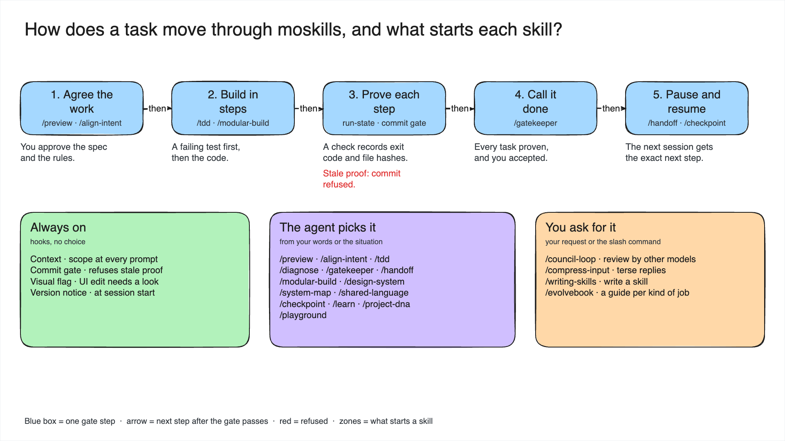
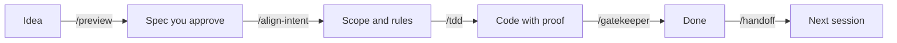
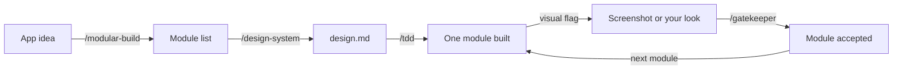

# moskills

[](https://github.com/Mouad1/moskills/actions/workflows/npm-checks.yml)
[](https://www.npmjs.com/package/moskills)
[](docs/evals.md)

Rules, skills and hooks that make an AI coding agent agree on the work, prove each step, and stop before it says "done".

- You ask in plain words. The agent picks the skill.
- Each step has a gate: a check, a screenshot or your approval.
- A changed file makes the proof stale, and moskills refuses the commit.

It works in Claude Code as a plugin, and in Codex, Antigravity and other agents through the CLI.



## Install

**Claude Code**, inside Claude Code:

```text
/plugin marketplace add Mouad1/moskills
/plugin install moskills@moskills
/moskills-init
```

**Other agents**, in a terminal:

```sh
npm install -g moskills
cd your-project && moskills init --agents
```

Run `init` once per project. Then ask the agent: "Build this feature" or "Fix this bug". Updates, uninstall and the file list are in the [install guide](docs/install.md).

## What starts each skill

| Starts | Skill | What it does |
|---|---|---|
| Always on (hooks) | Context | Puts the scope and the next step into every prompt and after compaction. |
| Always on (hooks) | Commit gate | Refuses `git commit` when a proof is missing, failed or stale. |
| Always on (hooks) | Version notice | Says at session start when a newer moskills exists. |
| Always on (hooks) | Visual flag | Marks a task after a UI edit. A screenshot or your look is then required. |
| Agent picks it | `/preview` | Turns a vague idea into a spec and a one-page PRD that you approve. |
| Agent picks it | `/align-intent` | Fixes the goal, scope, success criteria and rule IDs before code. |
| Agent picks it | `/tdd` | Writes a failing test, then the code, and records the proof. |
| Agent picks it | `/diagnose` | Reproduces a bug and finds the root cause before any fix. |
| Agent picks it | `/gatekeeper` | Answers "is it done?" with the checks: Finished or Still not done. |
| Agent picks it | `/handoff` | Saves the exact next step so the next session can continue. |
| Agent picks it | `/checkpoint` | Records progress, evidence and blockers after a milestone. |
| Agent picks it | `/modular-build` | Builds an app one module at a time. You accept each module. |
| Agent picks it | `/design-system` | Keeps one `design.md` with the colours, type and spacing of the UI. |
| Agent picks it | `/playground` | Makes one HTML page with sliders when you must change a value to see a result. |
| Agent picks it | `/system-map` | Maps modules and dependencies before a change to unfamiliar code. |
| Agent picks it | `/shared-language` | Keeps one term per concept in a glossary that the lint checks. |
| Agent picks it | `/learn` | Turns a correction into a rule in `tasks/lessons.md`. |
| Agent picks it | `/project-dna` | Records a decision and a replay prompt to build the same thing again. |
| You ask | `/council-loop` | Asks reviewers from other model providers and loops until they agree. |
| You ask | `/compress-input` | Makes the agent reply in fewer words. |
| You ask | `/writing-skills` | Writes or changes a skill, with trigger tests and evals. |
| You ask | `/evolvebook` | Keeps one guide per kind of job that improves on each run. |

"Agent picks it" means the agent starts the skill from your words or from the situation. A slash command starts any skill directly. The [trigger evals](docs/evals.md) test each "Agent picks it" skill on a direct request and an indirect request.

Note on `/council-loop`: how the agent reaches the other providers depends on the host. Some hosts have a delegate tool for other models, and other hosts use each provider's CLI. The report says how many providers took part.

## Scenario 1: a new project without a UI



| You say | What starts | What happens |
|---|---|---|
| "I want a CLI that renames photos by date." | `/preview` | The agent asks one question at a time and writes a spec. You approve it. |
| "Pin down what done means for the first version." | `/align-intent` | The agent writes the goal, the non-goals and the rules with their checks. |
| "Build it." | `/tdd` | Each task starts with a failing test. The check result is recorded. |
| (You edit a file after the test ran.) | Commit gate | The proof is stale. The commit is refused until the test runs again. |
| "The build broke." | `/diagnose` | The agent finds the root cause before it changes code. |
| "Is it done?" | `/gatekeeper` | The agent runs the checks and reports Finished or Still not done. |
| "Save where we are, I must stop." | `/handoff` | The next session starts at the exact next step. |

## Scenario 2: a project with a UI



| You say | What starts | What happens |
|---|---|---|
| "Build a booking app: auth, calendar, payments." | `/modular-build` | The agent splits the app into modules. You accept the order. |
| "Pick the colours and spacing for the app." | `/design-system` | The agent writes one `design.md`. The UI code uses only those values. |
| "Build the calendar module." | `/tdd` | Tests first, then the code, with recorded proof. |
| (The agent edits a UI file.) | Visual flag | The task needs a screenshot or your look before it is done. |
| "I can't picture how the price changes with the duration." | `/playground` | The agent makes one HTML page with sliders for the price inputs. |
| "Is the calendar module done?" | `/gatekeeper` | Every check and the visual check must pass. Then you accept the module. |
| "No, we always use pnpm here." | `/learn` | The agent records the rule in `tasks/lessons.md`. |

## What `init` adds to your project

- **Rules** in `.claude/standard/`, imported by `CLAUDE.md`. `moskills sync` upgrades them.
- **Skills and commands** in `.claude/skills/` and `.claude/commands/`.
- **Your files**, created once and never overwritten: `docs/prd.md`, `docs/rules.md`, `.claude/STATE.md` and `tasks/`.
- **Guards**: a Git pre-commit hook and the Claude Code hooks above.

`moskills doctor` reports drift. `moskills status` prints the goal, the finished work, the blockers and the next step.

## More docs

- [Quick start](docs/quick-start.md), [command reference](docs/command-reference.md), [install guide](docs/install.md)
- [Architecture](docs/architecture.md), [diagrams](docs/diagrams/README.md), [STE80 writing rules](docs/ste80.md)
- [Trigger evals](docs/evals.md), [changelog](CHANGELOG.md), [roadmap](docs/roadmap.md)

Do not push directly to the default branch. Push a branch and open a pull request. Run `npm test` before you do.

Built by [Mouad Belghiti](https://belghitis.com).
