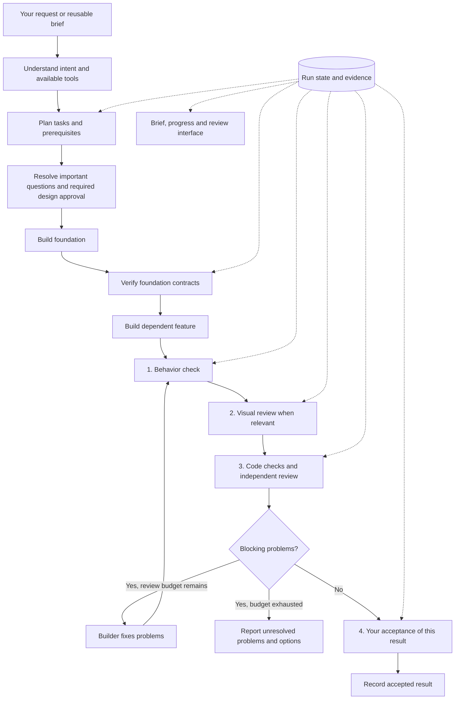
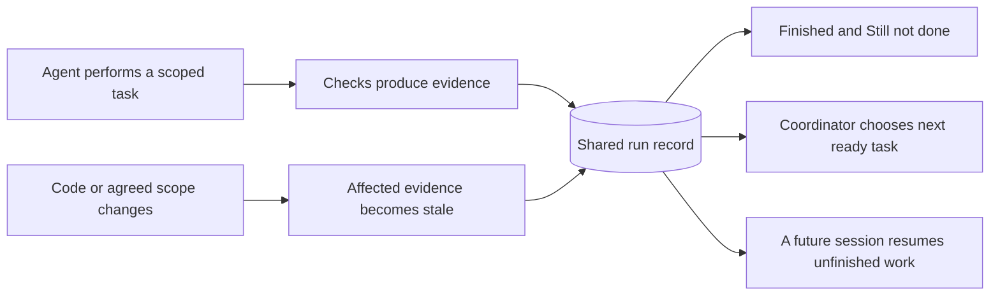
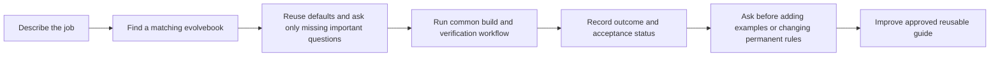

# moskills: a workflow you can trust and resume

moskills helps people work with coding agents deliberately: understand the goal,
divide the work, verify results, remember progress, and hand off cleanly.

The direction described here is simple: install once, initialize each project
once, then ask for the result in ordinary language. The agent chooses the relevant
workflow instead of expecting people to remember a sequence of slash commands.

This guide explains the proposed architecture. The current repository already
ships skills, project rules, installation tools, checkpoints, a validation workflow
and a preview companion. The integrated scheduler, durable run engine, four-gate
enforcement, workflow dashboard and public npm package are still planned work.
Use the roadmap below to distinguish the existing foundation from the proposal.

## The workflow at a glance

Think of moskills as a team coordinator with a shared notebook and proof attached
to every completed check. You describe the result. The coordinator chooses the
process, delegates suitable work and remembers where the team stopped.



Solid arrows show work moving through its checks. Dotted arrows show steps reading
or updating the shared record. The interface displays that same record; it does
not keep a competing checklist.

This is the substantial-feature path. An explanation stays read-only. A small
documentation edit takes a shorter path. Backend work can mark visual review as
not applicable with a reason. Missing evidence for a required check remains
unknown and blocks acceptance.

## What each part does

| Part | Responsibility |
| --- | --- |
| Router | Recognize whether the request is a feature, bug, explanation, review, UI change or continuation |
| Planner | Define the result, success criteria, task boundaries and prerequisites |
| Builder | Implement one scoped task and return its changes and verification evidence |
| Verifier | Run meaningful checks and compare observed results with agreed criteria |
| Challenger | Look for concrete defects in the result without relying on the builder's success narrative |
| Coordinator | Decide which task is ready, resolve findings and keep the run record current |
| User | Make material product decisions and accept the specific finished result |

Roles are responsibilities, not hardcoded model names. Host adapters use the tools
and models actually available. A serial path remains available when delegation is
unsupported; it must disclose that independent agent review was unavailable.
Projects requiring independent review wait for a supported reviewer or a human.

## Run state and evidence: the notebook and its proof

**Run state** records what is happening: the goal, agreed scope, task status,
dependencies, finished work, unfinished work, blockers and next action.

**Evidence** supports claims about that work: test output, screenshots, code review
findings, commands and exit results, and the user's acceptance of a specific result.

Neither is another agent. They are saved records that agents and people can inspect.



For example, run state says "expired reset links are rejected." Evidence points
to an observed test proving that behavior for the version of code checked. An
agent's claim that it works is not sufficient.

When code changes, affected evidence becomes stale. The corresponding check
returns to Still not done until it runs again. History stays visible, so people
can see what passed previously and why another check is now needed.

The proposed local layout separates installation metadata from execution records:

```text
.moskills.json                 Installation version and configuration
.moskills/runs/<run-id>/
  run.json                    Current run, tasks, dependencies and gate results
  events.ndjson               Append-only history of decisions and transitions
  brief.md                    Goal, scope, constraints and success criteria
  evidence/                   Check outputs and references to reviewed artifacts
```

One coordinator owns state updates. Checkpoints and the dashboard derive their
status from that source. Optional memory holds durable preferences and lessons,
with short references to runs. If a host mandates a canonical work-state tool,
its adapter uses that source and labels local exports as derived records.

## Finished and Still not done

Every run exposes both lists. They come from the saved state rather than two
independently maintained documents.

| List | What belongs there |
| --- | --- |
| Finished | Tasks with current proof that all required checks and task-level acceptance are satisfied |
| Still not done | Pending or running work; failed, blocked, unknown or stale checks; outstanding review and final acceptance |

Each unfinished item identifies its owner, reason or blocker, prerequisite and
next concrete action. A written implementation can be ready for review while the
overall result remains unaccepted. Cancelled or removed scope retains its reason
in history and is never counted as finished.

The list updates after meaningful changes and survives interrupted chats. Saying
"continue" restores it and resumes the earliest incomplete step whose prerequisites
are satisfied. The overall run has no unfinished required work only after final
acceptance is recorded.

## Example: add password reset

You ask: **"Let people reset forgotten passwords."**

1. The planner separates reset-link logic from the reset form. The form needs a
   verified link contract before implementation starts.
2. A foundation builder implements the link logic. Tests cover valid links,
   expired links and reuse of a link already consumed. Their output is saved.
3. A feature builder implements the form. Tests and desktop/mobile previews
   provide evidence for behavior and appearance.
4. The challenger tests a missing case: request two links, reset with one, then
   try the older unused link. It still works. The original tests did not cover
   a second outstanding link.
5. The coordinator records that defect in Still not done. The builder fixes it;
   affected behavior and code checks run again, plus visual checks where affected.
6. When required checks pass and review blockers are resolved, the result becomes
   ready for your acceptance. Your acceptance is recorded against that result.

During the fix, the progress view could show:

| Item | State | Evidence or next action |
| --- | --- | --- |
| Reset-link contract | Still not done | New failure reopens affected contract verification |
| Reset form appearance | Finished | Unaffected visual checks remain valid; recheck any later UI effects |
| Invalidate other outstanding links | Still not done | Builder fixes the reported failure |
| Recheck the integrated result | Still not done | Rerun affected tests after the fix |
| Final acceptance | Still not done | Present corrected result after verification |

If the chat stops here, a new session resumes the open defect and its checks.
It does not need the original conversation to rediscover the plan.

## Four quality gates

| Gate | Question | Evidence |
| --- | --- | --- |
| Behavior | Does it do what we agreed? | Observed tests and contract checks |
| Visual | Does the interface match agreed design and remain usable? | Rendered result, relevant viewport checks and accessibility review |
| Code | Are correctness, architecture and maintainability requirements satisfied? | Available static checks and reproducible independent findings |
| Human | Do you accept this specific result? | Explicit acceptance tied to scope and artifact version |

Gates can pass, fail, remain unknown, or be not applicable with a reason. Required
failures and unknowns block progress. Tool unavailability does not make a required
check pass or become not applicable.

Fixes return through affected verification. The proposed review budget is an
initial independent review plus at most two fix/re-review rounds. If blocking
issues remain, the run stops automatic looping and presents unresolved issues
and options. Reaching the budget never converts failure into success.

Acceptance, permission to commit, permission to push, permission to merge and
permission to deploy are distinct. One user instruction can explicitly authorize
several actions, but accepting a result alone does not authorize all of them.

## Scoped agents and safe parallel work

Fresh agent contexts keep intermediate exploration out of the coordinator's
conversation. Each brief supplies the task goal, approved constraints, inputs,
owned files or workspace, prerequisite contracts and expected evidence.

Context isolation does not isolate files. Overlapping writers need serialization
or separate workspaces with explicit integration checks. Independent research or
tasks with disjoint ownership can run concurrently. Execution order follows
dependencies rather than component size.

Builders can resolve routine issues within their brief. They escalate scope
changes, incompatible contracts, missing required capabilities and new permission
needs. Expected failing tests during TDD do not trigger unnecessary escalation.

Delegation can increase token use and coordination cost. Use it where isolation,
independence or parallelism helps, and compare equivalent tasks before promising
cost savings.

## Evolvebooks and a friendly interface

An evolvebook is a reusable guide for one kind of job, such as an article, a
landing page or a backend module. It supplies an approved brief, examples, choices
and checks. The common workflow handles scheduling, evidence and acceptance.



The proposed interface has three views: Brief, Progress and Review. It shows the
goal, current work, proof and decisions needing the user's judgment. Technical
details remain available without dominating the main flow.

Forms support keyboard use, clear defaults, validation and explicit submission.
Questions already answered in the request should not be asked again. Browser
reconnects and new screens preserve decisions. A draft selection is not final
approval; acceptance identifies the current result and trusted user action.

When the host has no suitable UI, the same workflow uses chat and Markdown.
Personal memory, communication styles and extra plugins remain optional for
community users. Public operation must not depend on the author's private setup.

## Installation: available today and planned next

The repository currently provides a Claude Code plugin and a standalone shell
installation route for supported agents. Refer to the repository README for
current installation instructions. Node is required for the preview companion;
the full proposed workflow does not yet ship as an integrated runtime.

Simple npm/npx installation is a required future deliverable. These target
commands are **planned, not working public installation instructions**:

```sh
# Planned: initialize a project without permanent global installation.
npx moskills@latest init

# Planned alternative: keep the CLI available across projects.
npm install -g moskills
moskills init
```

The audit on 2026-10-08 found no repository `package.json`, and the public registry
query for `moskills` returned E404. The name is not reserved by this observation.
Publication, clean installation and real supported-agent use must be verified
before these commands are advertised as available.

Project initialization should detect supported agents, preserve user-owned files,
install durable routing rules and ask only material project-specific questions.
Afterward, users open the project in their coding agent and describe their task.
Installing moskills does not install an AI subscription or another coding agent.

An npm package must bundle its required assets, exclude private working records,
avoid configuration writes during npm lifecycle scripts, and avoid permanent links
into transient npx caches. Npm-owned installations use npm for update/uninstall;
standalone installations retain their separate lifecycle.

Initial platform commitments remain macOS/Linux and Windows through WSL. Native
Windows support needs end-to-end implementation and validation before being claimed.
New dependencies and external publication require applicable user authorization.

## Finished: existing foundation and completed design work

- [x] Focused skills for intent, mapping, testing, diagnosis, checkpoints and validation.
- [x] Versioned managed rules, installer tools and optional staged-file guard.
- [x] Preview companion with local HTML and live reload.
- [x] Repository audit and architectural proposal.
- [x] Existing baseline test run: 55 tests passed on 2026-10-08.
- [x] Explicit requirements for Finished / Still not done and simple public installation.

These items do not prove that the proposed engine is implemented. The existing
guard checks staged hazards; it does not enforce all four quality gates.

## Still not done: implementation roadmap

- [ ] Fix installation ownership, safe initialization reruns and manifest validation.
- [ ] Deliver portable default routing with supported capability fallbacks.
- [ ] Implement authoritative run state, dependency barriers and evidence invalidation.
- [ ] Enforce gate transitions and bounded independent review loops.
- [ ] Generate Finished / Still not done views from that shared state.
- [ ] Fix preview decision persistence and shell-interpreter compatibility.
- [ ] Build brief forms, progress and revision-bound review controls.
- [ ] Package the reviewed evolvebook implementation for public users.
- [ ] Build and test npm/npx package distribution.
- [ ] Publish an authorized release and verify clean installation and agent use.

Deliver these as reviewable changes, with evidence attached to each milestone.
Instruction-only operation remains advisory until a trusted validator actually
rejects invalid transitions. Never label the proposed system enforced prematurely.

## Documentation diagrams are part of the standard

Every documentation artifact created or updated should include at least one
meaningful diagram. Prefer Mermaid for Markdown and Obsidian; explain its labels
and how it relates to the text. Diagrams must show real structure, sequence,
dependencies or decisions, and change when the described behavior changes.

This page includes workflow, state/evidence and evolvebook diagrams. The same
diagram policy is included in the managed and legacy moskills system rules.

An editable [architecture canvas](architecture.canvas) accompanies this guide
for Obsidian users. Inline Mermaid diagrams keep the Markdown readable on its own.

## Contributing and evaluating the proposal

Community feedback is useful when tied to a scenario: what was requested, what
route ran, which checks were required, what evidence existed and where progress
became blocked or confusing.

Evaluate fresh installation, reruns, missing capabilities, interrupted sessions,
stale evidence, overlapping writers and duplicate UI submissions. Measure routing
errors, unnecessary questions, elapsed time and token use where available.

Diagrams and progress views help people inspect the workflow. Trust comes from
observed behavior and proof, with clear limits on what has not been verified.

## References

- [moskills repository](https://github.com/Mouad1/moskills)
- [OpenAI skills: implicit invocation and distribution](https://learn.chatgpt.com/docs/build-skills)
- [OpenAI subagents: delegation and coordination](https://learn.chatgpt.com/docs/agent-configuration/subagents)
- [Claude skills in isolated subagents](https://code.claude.com/docs/en/skills#run-skills-in-a-subagent)
- [npm executable packaging](https://docs.npmjs.com/cli/v12/configuring-npm/package-json/#bin)

By Mouad Belghiti. Published repository materials use the repository's MIT license.
