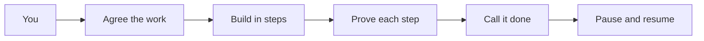

# Part inventory

Single source for the Excalidraw diagrams in this folder. Every box in a diagram is one row here.

"The system" is: the moskills rules, skills and hooks inside one project; the agent and you are outside.

Labels: each arrow is a gate. The work moves to the next step only when the gate passes.

## Rows

| id | Kind | Name | Generic role | Brings | Group | Colour | Talks to | Runs | Machine | Status | Source |
|---|---|---|---|---|---|---|---|---|---|---|---|
| agree | brick | /preview · /align-intent | Agree the work | The agent no longer codes from a vague brief | gate flow | `#a5d8ff` | build | on demand | any | built | templates/claude/skills/preview/SKILL.md |
| build | brick | /tdd · /modular-build | Build in steps | Each change has a failing test first | gate flow | `#a5d8ff` | prove | on demand | any | built | templates/claude/skills/tdd/SKILL.md |
| prove | brick | run-state · commit gate | Prove each step | A stale proof blocks the commit | gate flow | `#a5d8ff` | done | each commit | any | built | hooks/hooks.json |
| done | brick | /gatekeeper | Call it done | Done means every check passed and you accepted | gate flow | `#a5d8ff` | pause | on demand | any | built | templates/claude/skills/gatekeeper/SKILL.md |
| pause | brick | /handoff · /checkpoint | Pause and resume | The next session starts at the exact next step | gate flow | `#a5d8ff` | agree | on demand | any | built | templates/claude/skills/handoff/SKILL.md |

## Notes

- **Merged rows**: each step row stands for the skills named in its Name column.
- **How the rows were checked**: from the skill files and `hooks/hooks.json`.
