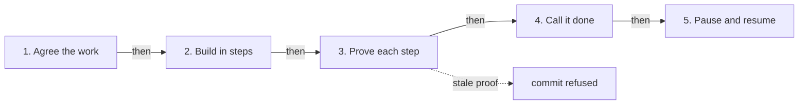

# How does a task move through moskills, and what starts each skill?

Talking points:

- Each step is a gate. The work moves on only when the gate passes.
- A check records its exit code and file hashes. A changed file makes the proof stale, and the commit is refused.
- Hooks are always on. The agent picks most skills from your words or the situation. Four skills start when you ask.

- **Business owner:** the agent cannot call work done without proof and your acceptance.
- **Learner:** the five steps are the habits of a careful engineer, made into rules.
- **Developer:** the gates are hooks and `run-state` records; the skills are in `templates/claude/skills/`.

Source: `hooks/hooks.json`, `templates/claude/skills/*/SKILL.md`.
