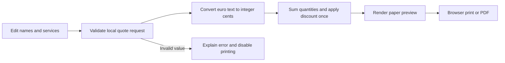

# Clearquote

A local draft quote builder for freelancers. Edit business and client names, add or remove services, set quantities and euro prices, then print a proposal.

## Run

Requires Node.js 18 or newer. No install step or external dependencies. Automated checks here ran on Node.js 26.5.0; Node.js 18 was not exercised. This demo is available in the repository source; the published moskills 0.8.1 package does not contain it.

From the repository root:

```sh
cd docs/examples/quote-builder
npm test
npm start
```

Open [Clearquote](http://127.0.0.1:3000). Stop the server with Ctrl+C.

## Try a quote

1. Set **Your business** to North Studio and **Client name** to Avery & Co.
2. First **Service name**: Photography. **Unit price (€)**: 200. **Quantity**: 1.
3. Second **Service name**: Editing. **Unit price (€)**: 100. **Quantity**: 1. Use **Add service** if you need another row.
4. Set **Discount (%)** to 10. Choose **Update quote** or wait for the preview to update.
5. Preview shows subtotal **€300.00**, discount **−€30.00**, total **€270.00**.
6. Choose **Print quote**. In your browser print dialog, print or save as PDF. Only the quote document is included.

Try one €50 service with quantity 2 and discount 0: total **€100.00**. **Remove service** removes a row. **Clear quote** starts an empty draft. Tab moves through labelled fields and buttons; focus remains visible. Invalid input shows an error, clears the preview and disables printing.

## How it works



`price.cjs` and its regression tests copy the reviewed pricing lab. New tests cover pricing behavior, decimal input validation and HTTP routes. See [observed checks and remaining work](TEST-RESULTS.md).

## API

`POST /api/quote`, `Content-Type: application/json`:

```json
{
  "business": "North Studio",
  "client": "Avery & Co.",
  "discount": "10",
  "items": [
    { "service": "Photography", "unitPrice": "200", "quantity": "1" },
    { "service": "Editing", "unitPrice": "100", "quantity": "1" }
  ]
}
```

Success: `200` with trimmed names, `currency: "EUR"`, canonical items (`service`, `unitPriceCents`, `quantity`, `totalCents`) and `subtotalCents`, `discountPercent`, `discountCents`, `totalCents`. Example total: `27000` cents. Error: `{ "error": "description" }`; `400` invalid JSON or values, `413` over 32 KB, `415` wrong content type, `405` unsupported method, `404` unknown path.

Only `/`, `/style.css`, `/app.js` are served. Source, tests and logs stay outside public routes.

## Limits

Prototype; customer validation still needed. No saved drafts, tax calculation, email, payment, database or hosting. Reloading restores the sample. Maximum 100 services; names at most 120 characters. Unit prices use decimal points and at most two fractional digits; no currency signs, commas or exponents. Quantity is a nonnegative whole number. Discount is 0–100, including decimal rates; the discount amount rounds half up to a cent. Money, line totals and subtotal must stay within JavaScript's safe integer range. Runs only on loopback port 3000. Desktop/mobile layout and one-page Chrome print preview were manually checked. Saving the PDF and customer validation still need your check.
