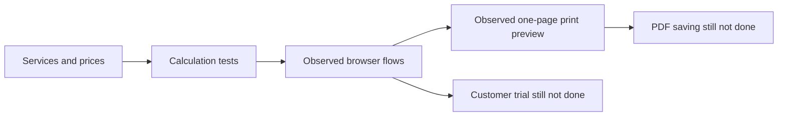

# Quote builder: observed checks

Draft reference implementation for the community guide. Browser checks ran on 2026-10-12; automated checks were repeated on 2026-10-13.

## Finished

- Backend: 28 tests pass, including 13 reviewed pricing regressions, 10 quote-adapter tests and five HTTP-handler checks. New checks failed before implementation. Split UTF-8 corruption was reproduced, then fixed.
- Browser: photography €200 plus editing €100 with 10% discount gives €270. Doubling photography gives €450; adding €50 travel gives €495; removing travel restores €450. One €50 service with quantity two and no discount gives €100.
- Accented business and Arabic client names remain intact. Invalid `10.999` unit price clears the quote and disables printing. Add, remove, clear and reload flows work.
- Keyboard Tab moves from business to client. Desktop and 390-pixel mobile layouts were inspected; no horizontal overflow was observed.
- Chrome's actual print preview contains one page with business, client, services, €300 subtotal, €30 discount and €270 total. Editor controls are absent.
- The pricing module matches the reviewed lab copy. Verification used Node 22.17.1 and 26.5.0.

## Still not done

- Saving the PDF was not verified. Native window context changed during that check; no PDF file is claimed. Complete this check before sharing an actual quote.
- Human acceptance, customer trials, willingness to pay, other platforms and screen-reader testing remain unverified.
- This is a local reference demo. Interview notes and paid-pilot validation remain user work.

Reproduce: run `npm test`, then `npm start`; follow the README's quote exercise. The copyable guide prompt is a task brief. This fixture is one checked implementation; it does not prove every agent host will produce identical results. No Git commits or publication were performed.
