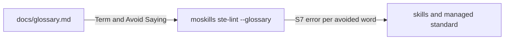

# moskills glossary

These are the shared-language entries of moskills itself. Each entry names one term and the words to avoid for the same concept. The lint reads them with `--glossary`, and `npm test` fails when a skill or the managed standard uses an avoided word.



Labels: the lint turns each "Avoid Saying" word into an S7 error that names the term to use.

Add an entry when two words name one concept in the skills. Use the entry format of the `shared-language` skill.

```text
Term: handoff
Meaning: The note in .claude/STATE.md that lets the next session continue the work.
Use When: Pausing work or resuming it in a new session.
Avoid Saying: hand-off
Code Names: handoff skill, /handoff
Example: Write a handoff before you pause.

Term: subagent
Meaning: An agent that the main agent starts for one task, with its own context.
Use When: A builder check, a review delegate or a parallel task.
Avoid Saying: sub-agent
Code Names: Agent tool
Example: Give the spec to a fresh subagent.

Term: frontend
Meaning: The part of a project that the user sees and touches: pages, components, styles.
Use When: Deciding whether the Visual Companion or a visual check applies.
Avoid Saying: front-end
Code Names: visual-flag
Example: The project has a frontend, so start the Visual Companion.

Term: evolvebook
Meaning: One guide per kind of job that improves on every run.
Use When: A task matches a book in EVOLVEBOOKS.md.
Avoid Saying: evolve book, evolve-book
Code Names: evolvebook skill, evolvebook.sh
Example: Using the article evolvebook.

Term: STE80
Meaning: The writing rules S1 to S8 of docs/ste80.md.
Use When: Writing skill steps, the standard, or a document for a reader.
Avoid Saying: STE 80, STE-80
Code Names: moskills ste-lint
Example: The skill steps follow STE80.
```
