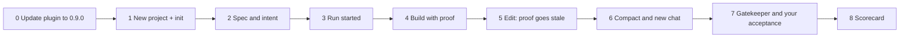

# Live session: build a real project with moskills 0.9.0

A script for the first live trial in Claude Code: create a new project (the
example is **Insta Route, mobile version**) with the latest moskills and check
that the workflow runs itself. Each step lists what to say, what to look for,
and where to record it. Steps 1–9 of the [A–Z walkthrough](testing-from-a-to-z.md)
were dry-run on 0.9.0 in a disposable lab; this session is the first test with a
live agent.



Each box is one section below. The run (steps 3–7) is what 0.9.0 adds:
proof saved per check, reopened when files change, and shown to the agent on
every prompt.

## 0. Before the session (5 minutes)

1. Merge the 0.9.0 pull request so `main` carries version 0.9.0.
2. In Claude Code: `/plugin marketplace update moskills`, then
   `/plugin update moskills@moskills`, then restart Claude Code.
3. Check Node.js 18+ (`node -v`). The run-state engine and the plan reminder
   need it.
4. npm still has 0.8.1. Use the plugin for this session, not `npm install`.
5. With only the plugin installed, your own terminal has no `moskills`
   command. For the terminal checks below, either ask the agent to run them, or
   copy the command from the `Record proof:` line the reminder shows (for
   example `sh '/path/to/plugin/moskills'`).

**Look for:** after step 1 below, `/moskills-doctor` prints `OK v0.9.0` and
`run-state: ready`.

## 1. New project

```sh
mkdir insta-route-mobile && cd insta-route-mobile && git init
```

Open the folder in Claude Code, then run `/moskills-init`.

**Look for:** `CLAUDE.md`, `.claude/STATE.md` (with `## Findings`),
`tasks/todo.md`, `tasks/lessons.md`, `.moskills.json` with version 0.9.0, and
no `memorize` skill under `.claude/skills/`.

## 2. Spec and intent

Say, in your own words:

> I want a mobile version of Insta Route: \<one paragraph: who uses it, the one
> job it must do first, what "done" looks like\>. Spec it first, agree the
> acceptance criteria with me, then plan the first small slice. Do not commit.

**Look for:** the agent routes to `/preview` and `/align-intent` without you
naming them; at most five questions; a logic model written under `Current run`
in `.claude/STATE.md`.

## 3. Run started

Once the slice is agreed:

> Start a moskills run for this slice, one task per layer, and record every
> check through it.

**Look for:** `.moskills/runs/default/run.json` exists; a **Run proof** block
appears in `.claude/STATE.md`; on your next prompt the agent's context shows
`Active run: ...` and a `Record proof:` command. Asking it to start the run
again must not wipe it (init refuses without `--force`).

## 4. Build with proof

> Build the first task test-first. Record the failing test and the passing test
> through the run.

**Look for:** the agent runs checks with `run-state wrap --task ... --auto-complete`
instead of typing "tests pass". A task with only a failing check stays
`still not done`. Ask "Start moskills dashboard and give me the URL" to watch
it in a browser (it listens on 127.0.0.1 only).

## 5. Proof goes stale

Edit one file in the run's scope yourself (add a comment), then send any
message, for example "Continue."

**Look for:** the reminder says `stale proof: task-N (run resume)` before the
agent does anything; the agent reruns that check instead of trusting the old
result.

## 6. Compaction and a fresh chat

1. Run `/compact`, then ask "What's next?" The run lines and five note lines
   should come back without you repeating the plan.
2. Run `/checkpoint`, close the chat, open a new one, and say "Continue."

**Look for:** the new chat runs `run-state resume` first, names the next ready
task, and does not ask you to retell the goal.

## 7. Gatekeeper and your acceptance

> Check this slice against the acceptance criteria and show me the result for
> acceptance.

**Look for:** gates reported as passed / failed / unknown with proof from the
run; the agent asks you before recording acceptance and never accepts for you.
Reply "I accept this slice", then ask the agent to run `moskills status`: it
shows `Human acceptance: accepted by ...`. Edit a scoped file and ask again: it
must show `pending (scope changed since acceptance)`.

## 8. Scorecard

Copy into `TEST-RESULTS.md` in the project and fill in pass / fail / unknown
with one line of evidence each.

| Check | Result | Evidence |
| --- | --- | --- |
| Plugin and project on 0.9.0, `run-state: ready` | | |
| Skills chosen without naming them | | |
| Run started once; re-init refused | | |
| Checks recorded through the run, not claimed | | |
| Plan reminder visible on prompts | | |
| Stale proof shown and rerun after an edit | | |
| Reminder back after `/compact` | | |
| New chat resumes from the run | | |
| Acceptance only after your reply; resets on edit | | |
| Run proof block matches `run-state status` | | |
| Dashboard shows the run | | |

Anything that fails or reads badly: say "learn from this" so `/learn` records
it, and note it for the next moskills change.

## Known limits

- The **Run proof** block refreshes when a run command runs; `moskills status`
  and the reminder check proof live.
- Codex and Antigravity have no per-prompt hook; they read the notes at session
  start.
- File hashes detect changes; they are not signatures. Leases coordinate agents
  on one machine.
