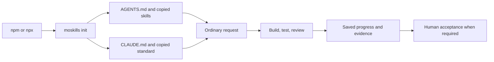

# moskills: install once, ask normally

Status: npm packaging exists in source; public registry publication is pending. Use a local tarball until release. For a safe, complete trial, follow the [A–Z testing walkthrough](testing-from-a-to-z.md).

## Install and use

Requires Node.js 18+ and a POSIX shell on macOS, Linux, or WSL. Use your existing AI agent and account.

After npm publication:

```sh
npm install -g moskills
cd your-project
moskills init
```

Without a global install: run `npx moskills init` in your project after release. Open Claude Code, Codex, or another agent that reads `AGENTS.md` and project skills. Restart an existing session if it already loaded instructions.

Ask normally: “Fix this bug”, “Build this feature”, “Review this change”, or “What is still not done?” Agent selects skills from installed descriptions. Slash commands remain optional; host must support and follow project instructions.

Default responses give outcome, evidence, and blocker/next step briefly. Ask for detail when needed. Installer warnings and errors remain visible; `--verbose` shows full output.

## Try unpublished package locally

From source checkout:

```sh
npm test
npm pack --pack-destination /tmp
npm install -g /tmp/moskills-0.8.0.tgz
```

Then run `moskills init` in your project. Local npx trial:

```sh
npx --yes --package /tmp/moskills-0.8.0.tgz moskills init
```

Package has no third-party npm runtime dependencies or installation lifecycle scripts. It bundles the shell CLI, copied skills/templates, evolvebook helper and guide, public diagram assets, the architecture guide and Obsidian canvas, and both Claude settings helpers in `lib/`.

## Installation flow



Project copies survive npx cache deletion and npm uninstall. Project-owned notes are seeded once. Repeat init/sync preserve edited managed files unless you explicitly use `--force`; doctor reports drift.

After registry release:

```sh
moskills doctor
npm install -g moskills@latest
moskills sync
npm uninstall -g moskills
```

npx users update project copies with `npx moskills sync`. Uninstalling CLI keeps project files. npm owns its executable and updates; global linking, standalone self-update, and launch-agent scheduling are rejected in npm mode.

## Evolvebooks and Claude plugin updates

Evolvebook creation, repeat checks, project links, and export work in the npm package. For project-only books:

```sh
moskills evolvebook setup --project-only
moskills evolvebook new release-guide --project --purpose "Release guide" --use-when "shipping code" --choices "topic,format"
moskills evolvebook repeat release-guide topic=runtime format=guide
moskills evolvebook link
moskills evolvebook export release-guide --out release-guide.md
```

`evolvebooks` is an alias of `evolvebook`; helper arguments and help pass through. Project-only setup saves the mode in the user's evolvebooks configuration, then books stay under the project `.evolvebooks/`. Project links point to those durable book copies. Read the [evolvebook guide](evolvebook.md) for other homes and the agent workflow.

`moskills plugin-autoupdate --check` reports Claude Code marketplace settings without rewriting them. `moskills plugin-autoupdate` enables that marketplace's automatic updates while preserving other settings. Those commands manage the Claude plugin; update the npm CLI through npm, then sync project copies. npm notices recommend `npm update -g moskills` and `moskills sync`.

## Run state and evidence

**Run state** is saved checklist: requested work, finished work, remaining work, and decisions needed. **Evidence** is proof: observed test output, reviewed diff, or actual UI screenshot.

Example: “Add a login form.” Build foundation, then form. Tests pass, screenshot review remains missing:

| Finished | Still not done |
|---|---|
| Form implementation | Visual review |
| Behavior tests with command/result | Human acceptance if required |

Passing tests do not prove appearance. Unavailable required checks stay `unknown`; task stays open. Changes invalidate affected earlier evidence. Required approval applies to reviewed result.

`.claude/STATE.md` and `tasks/todo.md` hold progress and evidence. Agents maintain these files; this release has no enforced run-state service or evidence database.

## Finished and still not done

Local package tests exercise packed global installs, npx cache cleanup, repeated init, dynamically newer upgrades, uninstall, paths with spaces, evolvebook setup/new/repeat/link/export, helper help, bundled assets, and read-only plugin update checks. The integrated suite includes upstream evolvebook and automatic-update regressions plus project safety checks. Local verification uses macOS with Node 26.5.0 and npm 11.17.0; other platform/version results require their own runs. An isolated Codex smoke scenario verifies ordinary bug routing after explicit instruction reads; host automatic loading and other agents remain separate checks.

CI configuration runs the same suite on Ubuntu and macOS with Node 18, 22, and 24. All six jobs passed for the 0.8.0 setup in [PR #20 CI](https://github.com/Mouad1/moskills/actions/runs/38147935144). These results cover package behavior; live agent and WSL trials remain separate checks. Configuration follows official [checkout](https://github.com/actions/checkout) and [setup-node](https://github.com/actions/setup-node) guidance.

Still not done:

- Public npm publication, which is not authorized by the merge approval.
- Native Windows support; use WSL.
- Live Claude Code, WSL, automatic instruction loading, and broader community/platform trials.
- Enforced run-state engine, interactive progress UI, and evolvebook UI forms from architecture roadmap. Plain Markdown evolvebook creation and export already work.

Documentation must include useful diagrams for workflows, dependencies, or architecture. Keep diagrams close to explained text.
