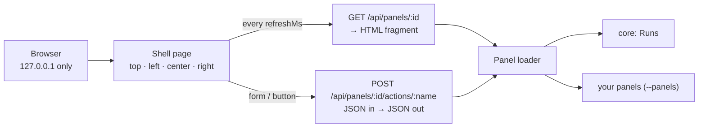

# Panel host — one local dashboard, plug-in panels

`moskills dashboard` starts a small local web dashboard. Everything on it is a **panel**: a folder you
can add or delete. moskills ships one core panel (Runs); other tools add their own with `--panels <dir>`.
No dependencies, no build step, no CDN.



- **Shell page**: lays out the four zones, refreshes each panel on its own timer, sends form submissions as JSON.
- **Panel loader**: reads every `panel.json`, skips invalid panels with a reason (shown on the page), never crashes because of one panel.

## Start it

```bash
moskills dashboard                                  # core panels, current project
moskills dashboard --panels ./my-panels --port 4050 # add your panels
moskills dashboard --no-core --panels ./my-panels   # only your panels
```

## Write a panel

```text
my-panels/
  todo/
    panel.json
    panel.mjs
```

`panel.json`:

```json
{ "id": "todo", "title": "Open tasks", "zone": "left", "order": 10, "refreshMs": 5000, "entry": "panel.mjs" }
```

| Field | Rules |
|---|---|
| `id` | lowercase letters, digits, dashes; unique |
| `title` | 1–60 characters |
| `zone` | `top` (status ribbon), `left`, `center`, `right` |
| `order` | lower first (default 100) |
| `refreshMs` | `0` = never, else ≥ 1000 (default 10000) |
| `entry` | `.mjs`, `.cjs`, `.js` or `.ts` (`.ts` needs Node ≥ 22.18), inside the panel folder |

`panel.mjs`:

```js
export async function render(ctx) {
  // ctx = { targetDir, config, escape, panelDir }
  const items = ["write docs", "<b>not bold</b>"];
  return { html: `<ul>${items.map((t) => `<li>${ctx.escape(t)}</li>`).join("")}</ul>
    <form data-action="add"><input name="text" placeholder="New task"><button>Add</button></form>` };
}

export const actions = {
  async add(ctx, body) {
    // body = { text: "…" } (form fields as JSON)
    return { message: `Added: ${body.text}` }; // `message` is shown as a toast
  },
};
```

- **Always escape data** with `ctx.escape(...)`: the HTML you return is inserted as is.
- Forms with `data-action="<name>"` and buttons with `data-action` (+ optional `data-payload='{"k":"v"}'`) call your actions; the panel refreshes afterwards.
- Inline `<script>` and `on…=` attributes do not run (Content Security Policy). Panels are HTML + CSS; behaviour goes in actions.
- Shell CSS classes you can use: `pill`, `dot ok|warn|err`, `muted`, `mono`, tables, `button`.

## Security model

| Threat | Protection |
|---|---|
| Other machines on the network | binds `127.0.0.1` |
| A website calling the dashboard via DNS rebinding | requests whose `Host` is not localhost get `403` |
| A website posting to an action | actions need a local `Origin`, `Content-Type: application/json` and header `X-Moskills-Action: 1` (a cross-site form can send none of these) |
| Injected markup running code | CSP `script-src 'self'`; panels escape data with `ctx.escape` |
| One broken panel | rendered as an error card; other panels keep working |

The older single-run view (`moskills run-state dashboard --run <id>`) follows the same rules.
