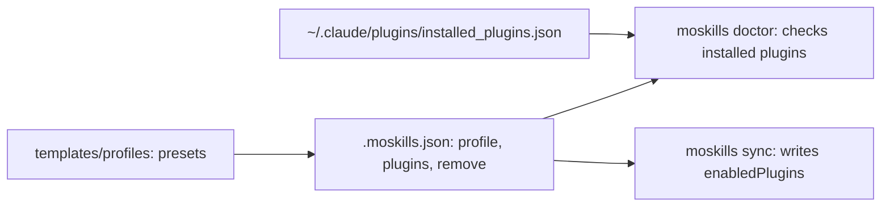

# Plugin profiles

A profile names the Claude Code plugins that a project uses. `moskills doctor` checks the installed plugins against the profile. `moskills sync` writes the profile plugins into `.claude/settings.json`.



The preset and the project overrides give one plugin list. Doctor compares that list with the installed plugins, and sync turns the list on for the project.

## Declare a profile

Add the fields to `.moskills.json`:

```json
{
  "profile": "web-app",
  "plugins": { "impeccable@impeccable": "^2.1" },
  "remove": []
}
```

| Field | Meaning |
|---|---|
| `profile` | A preset name from `templates/profiles/`: `web-app`, `cli` or `content`. Another name is an error. |
| `plugins` | Plugins to add, or a new range for a preset plugin. A key has the form `name@marketplace`. |
| `remove` | Preset plugins that the project does not use. |

A project can use `plugins` with no `profile`. A project with no `profile` and no `plugins` has no profile.

Until the plugin split, each preset lists only `moskills@moskills`. Add your other plugins with `plugins`.

## Ranges

| Range | Accepts |
|---|---|
| `1.2.3` | Only `1.2.3`. |
| `~1.2.3` | `1.2.3` and later patch versions: `1.2.x`. |
| `^1.2.3` | `1.2.3` and later minor and patch versions: `1.x.x`. For `^0.9`, only `0.9.x`. |
| `*` | Any version. |

Use caret ranges for your own plugins. The trigger evals check each release. Use exact versions for third-party plugins. Review each update before you change the version.

Some plugins record a git SHA as their version. A SHA matches only `*` or the same SHA. For another range, doctor gives a warning, not an issue.

## What doctor checks

| Result | Cause | Exit code |
|---|---|---|
| `missing plugin` | A profile plugin is not installed for this project. | 1 |
| `is outside` | The installed version is not in the range. | 1 |
| `extra plugin` | `.claude/settings.json` enables a plugin that is not in the profile. | 1 |
| `unknown profile` | The `profile` name is not a preset. | 1 |
| `warning: ... is unversioned` | The version is a git SHA, so doctor cannot check the range. | 0 |
| `profile: none (proposed: ...)` | The project has no profile. Doctor proposes a preset from the project files. | 0 |

Doctor reads the installed plugins from `$CLAUDE_CONFIG_DIR/plugins/installed_plugins.json` (default `~/.claude`). A user-scope plugin counts for each project. A project-scope plugin counts only for its own project. A user-scope plugin is never extra.

The proposal uses these signs:

- A web framework in `package.json`, or an `index.html` file, gives `web-app`.
- A `bin` entry in `package.json`, a `Cargo.toml` file or a `go.mod` file gives `cli`.
- Markdown files and no code manifest give `content`. The moskills seed files do not count.

## What sync writes

1. Sync keeps `profile`, `plugins` and `remove` in `.moskills.json`.
2. Sync sets each profile plugin to `true` in `enabledPlugins` in `.claude/settings.json`.
3. Sync sets a plugin from `remove` to `false` when the settings file enabled it.
4. Sync keeps all other keys and all other plugins in the settings file.

Sync does nothing to the settings file when the project has no profile. Sync does not install plugins. Install a missing plugin with `/plugin install <name@marketplace>`.

Profiles need Node.js 18 or later. Without Node.js, doctor prints `profile: skipped`, and sync does not write the settings file.
