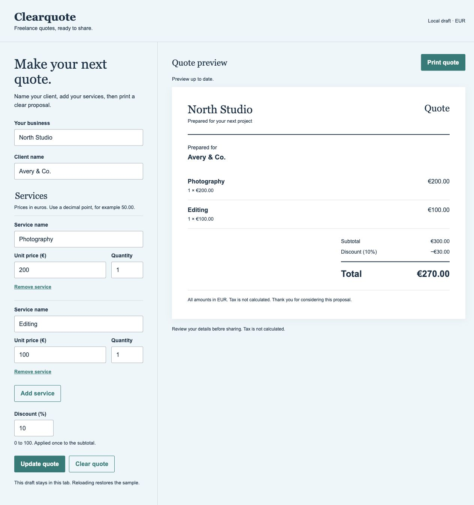
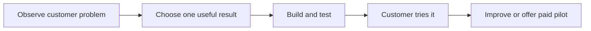

# Build something useful with moskills

Turn a repeated customer problem into a small tool. Describe the result; moskills guides your agent through building, checks, review, and saved progress.

## Three projects people understand

| Mini project | Problem to investigate | Possible paid offer |
| --- | --- | --- |
| **Quote builder** — recommended | Freelancers repeatedly calculate and format customer quotes | Customize branding, services, and prices for a business |
| **Service menu and inquiry page** | Customers keep asking what a business offers | Build a clear page, then maintain its content |
| **Client brief organizer** | Requests arrive incomplete across messages | Set up a form and organized brief for a service provider |

Start with someone you can reach. These are hypotheses; a demo does not prove demand.



## Find the problem first

Ask three potential users:

- “Show me the last time you did this.”
- “Which part took time or caused mistakes?”
- “What do you use now?”

Ask your agent:

> Turn these interview notes into one problem, one target customer, and the smallest useful tool. Separate observed facts from guesses. Keep the plan under 150 words.

## Set up once

Requires an agent that reads project instructions, Node.js 18+, and macOS, Linux, or WSL. Published npm installation was checked on 2026-10-13.

```sh
npm install -g moskills@0.8.1
MOSKILLS_DEMO=$(mktemp -d "${TMPDIR:-/tmp}/moskills-demo.XXXXXX")
cd "$MOSKILLS_DEMO"
moskills init
moskills doctor
pwd
```

Already installed? Skip npm installation. Doctor should report OK. Open the printed folder in your agent; start a fresh chat. [Installation options](npm-installation.md).

## Build your first useful tool

Paste:

> Build a local quote builder for a photographer. I can enter business and customer names, add services with quantity and price in euros, apply a discount, and print a clear quote. Start with photography €200 and editing €100: a 10% discount must give €270. Agree on rules first, test calculations before building the page, then check it in a browser on desktop and mobile. Keep it small, use no dependencies, and do not commit or publish. Finish with result, proof, and Still not done in five lines.

The [reference demo](examples/quote-builder/README.md) lives in this repository; npm 0.8.1 installs the agent workflow only. Calculations, desktop/mobile flows, and one-page print preview were checked; PDF saving remains your manual check.

If instructions were missed: “Read this project's AGENTS.md and installed moskills instructions, then retry.”



Tests prove calculations; a customer trial tests usefulness. Neither guarantees a sale.

## Check its potential

Ask normally:

| Say | Look for |
| --- | --- |
| “Review this quote builder. Use an independent reviewer if available; disclose limitations. At most two fix/re-review passes.” | Concrete defects fixed, affected tests rerun |
| “Save progress.” New chat: “Continue.” | Goal and unfinished work recovered |
| “Create a project-only evolvebook for customizing quote builders. Show the brief first.” | A reusable guide for the next business, approved before creation |

Let one potential customer try sample data. Observe difficulties; ask whether they want a paid customization.

**Finished:** observed checks. **Still not done:** unknown checks, defects, customer validation, your acceptance.

Today, agents maintain progress through instructions and saved notes. The enforced run engine, dashboard, and forms remain planned.

Share one demo, one proof, one customer lesson. [Full verification](testing-from-a-to-z.md). [Customer-discovery principle](https://www.ycombinator.com/library/Gh-yc-guide-to-business-models).
