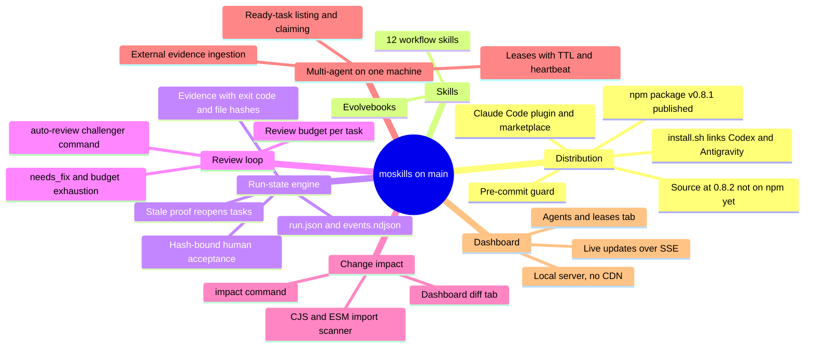
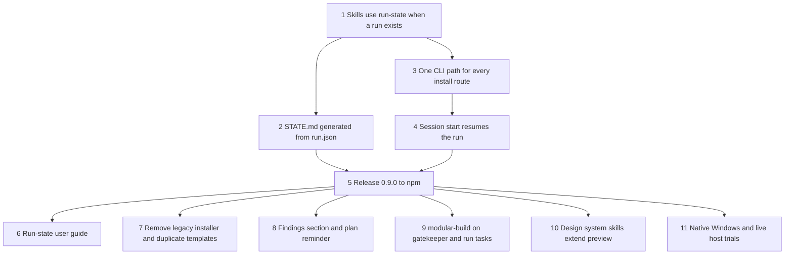

# moskills roadmap

Last reviewed: 2026-10-24. Source of truth for what is shipped, what is next,
and what is still planned. Each claim below was checked against the code on
`main`.

## 1. Summary

moskills is a skill pack and CLI for structured AI agent work, with no runtime
dependencies. It runs in Claude Code, and its skills link into Codex and
Antigravity. Alongside the skills, a run-state engine saves task progress with
evidence: command exit codes, output, and SHA-256 hashes of checked files. When
a checked file changes, its evidence goes stale and the task reopens. The engine
also enforces a review budget per task, follows imports to find affected tasks,
and lets several agents on one machine claim tasks without overwriting each
other.

Two limits to keep in mind:

- **Hashes are not signatures.** They detect accidental drift. Anyone who can
  edit `run.json` can rewrite the record.
- **Leases are local.** Agents coordinate through a lock file on one shared
  filesystem; there is no network service.

## 2. Shipped

| PR | Change |
| --- | --- |
| #23 | Five-line project status via `moskills status` |
| #24 | Quick-start guide and quote-builder demo |
| #25 | Run-state and evidence engine |
| #26 | Review budget, challenger gate, dashboard; 0.8.2 |
| #27 | `auto-review` challenger dispatch |
| #28 | Dashboard live updates (`/api/stream`) |
| #29 | `wrap` command evidence interceptor |
| #30 | Dependency graph scanner (`lib/dep-graph.cjs`) |
| #31 | Transitive invalidation and `impact` |
| #32 | Dashboard diff and impact tree (`/api/diff`) |
| #33 | Task leases with TTL heartbeat |
| #34 | Parallel ready-task listing and safe claiming |
| #35 | External evidence ingestion and agents tab (`/api/agents`) |

All 13 merged. `npm test` passes locally (shell suite plus 82 Node tests).

## 3. Overlap review

Checked on 2026-10-24 for features that do the same job twice.

| Overlap | Resolution | State |
| --- | --- | --- |
| `/memorize` and `/learn` both stored lessons | `/memorize` removed; `/learn` covers project lessons and personal preferences | Fixed |
| `/handoff`, `/checkpoint`, and the session protocol used three handoff formats and two files | `/handoff` writes one `Handoff` entry under `Checkpoints` in `.claude/STATE.md`, with the session protocol's fields | Fixed |
| `/align-intent` wrote to a `Current Intent Model` heading that the STATE template does not have | Writes to `Current run` | Fixed |
| `/checkpoint` and `/gatekeeper` both wrote gate results | `/gatekeeper` owns `Validation History`; `/checkpoint` references it | Fixed |
| Markdown gates (`/gatekeeper`, `STATE.md`) and the run-state engine track the same progress separately; no skill mentions `moskills run-state` | See todo 1 | **Open** |
| `templates/claude/STATE.md` and `CLAUDE.md` duplicate `templates/project/` for the deprecated `setupskill.sh` | See todo 7 | **Open** |
| `lib/claude-settings.py` and `.js` do the same thing | Intentional: Python first, Node fallback; tested to behave the same | Keep |

Rule for new work: before adding a skill or file, name the existing one that
owns the job. Extend it unless the new job is different.

## 4. Todos: toward a consistent, autonomous moskills

Ordered by dependency. Each step needs the ones above it.

The arrows show order: an item starts once the items pointing to it are done.

### P0: one source of truth (needed for autonomy)

1. **Connect the skills to the engine.** When `.moskills/runs/` exists,
   `/gatekeeper`, `/checkpoint`, and `/handoff` record checks with
   `run-state wrap` or `check`, complete tasks with `complete`, and get human
   sign-off with `accept`. Update `templates/managed/base.md` and
   `session-protocol.md`, which still say there is no runtime engine.
2. **Generate STATE.md from the run.** Add an export (for example
   `run-state status --md`) that writes Finished, Still not done, and Validation
   History into `.claude/STATE.md`, so the two records cannot disagree.
3. **One way to call the CLI.** Skills need a command that works for the plugin
   (`${CLAUDE_PLUGIN_ROOT}/moskills`), npm (`moskills`), and standalone
   (`~/.local/bin/moskills`) installs. Document it in the standard; have
   `moskills doctor` check it.
4. **Resume at session start.** When a run exists, the SessionStart hook prints
   the `run-state resume` summary: stale proof, next ready task, held leases.

### P1: release

5. **Release 0.9.0.** Bump `VERSION`, `package.json`, `plugin.json`, and
   `marketplace.json`; rename the `Unreleased` changelog section; publish to
   npm; verify a fresh registry install. Ship the run-state work now; design
   and modular-build come in a later release.
6. **Run-state user guide.** A short walkthrough in `docs/quick-start.md`:
   init, wrap a test, edit a file, see it go stale, accept.

### P2: remove leftovers

7. **Retire `setupskill.sh`** and the duplicate `templates/claude/STATE.md` and
   `CLAUDE.md`, with a migration note and updated tests.
8. **Findings and memory scope.** Done: the STATE template has a `## Findings`
   section, and the plugin re-injects the five status lines on every prompt and
   after compaction (`moskills context`). This replaces the 3-file pattern
   (`task_plan.md` / `findings.md` / `progress.md`), which would duplicate
   `tasks/todo.md` and `STATE.md`. `/memorize` was removed;
   `/learn` now also captures personal preferences.

### P3: new features, built on what exists

9. **`/modular-build`.** One module equals one group of run-state tasks. Its
   "no switching until tests, visual checks, and human acceptance pass" rule
   is `/gatekeeper` plus `run-state accept`; reuse them, do not add a second gate.
10. **Design system skills** (`design.md`, `/design-tokens`, `/design-shell`,
    `/components`, `/design-screen`). Not started. `/preview` already writes UI
    specs and runs a visual companion; the design file should be something
    `/preview` reads and writes, not a parallel flow.
11. **Platforms.** Native Windows (PowerShell/CMD) beyond WSL. Live trials in
    Claude Code Desktop, Codex, and Antigravity; until they are done, support for
    those hosts is installed but not observed.
