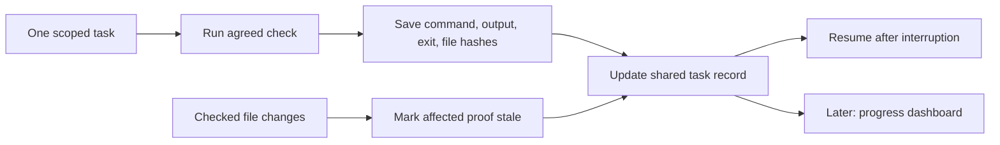

# Next milestone: saved progress with verifiable proof

This is a proposed implementation milestone, not a shipped feature. Build the record and its rules first; let the dashboard display that record afterward.

## What a user should experience

Ask “Continue.” moskills recovers the goal, exact files checked, unfinished work, and next action. Change a checked file: affected checks become unfinished. Missing proof never becomes a green tick.

The shared record controls status. The interface reads it; it does not create a competing checklist.

## Build a small vertical slice

1. **Record one run.** Save goal, agreed scope, tasks, prerequisites, Finished, Still not done, and next action. Write state atomically; retain an append-only event history.
2. **Capture one real check.** A local runner executes an agreed command and records its output, exit code, time, working directory, and relevant source hashes. Agent-written “passed” text is insufficient. Evidence references the acceptance criterion it checks.
3. **Reject unsupported completion.** Required checks without current evidence remain unknown or failed. A zero exit proves only that command succeeded; acceptance still depends on whether the agreed command tests the required behavior.
4. **Invalidate affected proof.** File or scope changes reopen the checks that depend on them. Preserve earlier results as history.
5. **Resume safely.** Read the latest valid record, inspect current files, and select the earliest unfinished task whose prerequisites pass. File locking prevents competing coordinators from overwriting each other.
6. **Bind acceptance to a result.** Human acceptance identifies the reviewed scope and file hashes; later relevant changes require renewed acceptance. It does not automatically authorize Git actions or deployment.

Use filesystem storage for the first prototype; no service or database is required. Support one active coordinator and one task before adding parallel scheduling. Preserve advisory operation for unsupported hosts; disclose which path is running. If a host mandates another canonical work-state source, use an adapter and make local exports derived views.

## Demonstrate it before adding UI

| Exercise | Required result |
| --- | --- |
| Record a failed pricing test | Behavior stays unfinished |
| Fix it and rerun agreed checks | Current evidence can pass |
| Edit a checked pricing file | Affected evidence becomes stale |
| Restart the coordinator | Goal, proof and next action survive |
| Claim success without evidence | Transition rejected |
| Two writers update the run | Conflict detected; state remains valid |
| Accept result, then change scope | Previous acceptance retained as history, current acceptance pending |

**Finished today:** written milestone and testable acceptance criteria.

**Still not done:** runner, storage, validation, adapters, and their tests. After this slice works, add dependency barriers and bounded review enforcement, then dashboard and evolvebook forms. Keep visual and human checks unknown until a trusted reviewer supplies their evidence.
