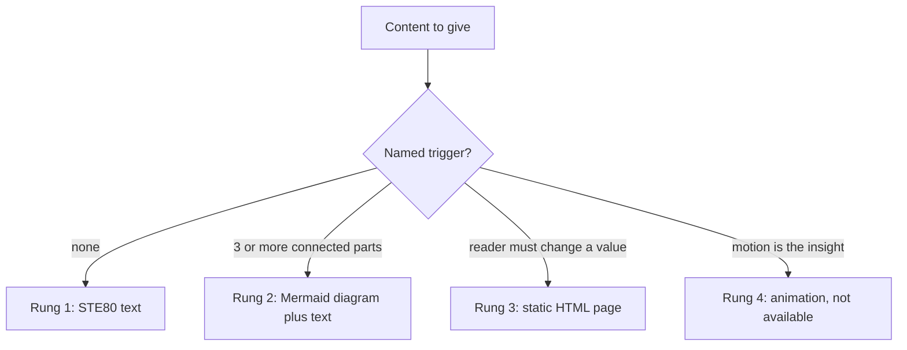

# STE80 and the output ladder

STE80 is the writing standard of moskills. It is a subset of ASD-STE100, the Simplified Technical English of aircraft maintenance manuals. The rules are in `templates/managed/base.md`, section "Writing (STE80)". This page gives the scope, the ladder and the reasons.

## The rules

STE80 uses the writing rules S1 to S8. It does not use the STE100 dictionary of approved words. That dictionary is the part that moskills does not adopt.

| ID | Rule | Check |
|---|---|---|
| S1 | A procedural sentence has 20 words or fewer. | Lint error |
| S2 | A descriptive sentence has 25 words or fewer. | Lint error |
| S3 | A paragraph has 6 sentences or fewer. | Lint warning |
| S4 | An instruction gives one action. Two actions that occur at the same time can share one instruction. | Lint warning |
| S5 | An instruction uses the imperative: "Run the tests", not "The tests should be run". | Lint warning |
| S6 | A sentence uses the active voice. | Lint warning |
| S7 | One term names one concept. A term from a `shared-language` "Avoid Saying" list is an error. | Lint error (`--glossary <file>` or `--avoid <term>=<use>`) |
| S8 | A sentence keeps its articles and verbs. Do not remove words to make a sentence shorter. | Reviewer |

The lint `moskills ste-lint` counts words as follows:

- A code span (text in backticks) counts as one word.
- A list item that starts with a number is a procedure. Other text is a description.
- The lint does not read frontmatter, code blocks, tables or quotes.

Source of the values: secondary summaries of ASD-STE100 agree on all of them. They agree on the word limits, the paragraph limit, one instruction per sentence and the imperative. The official Issue 9 text was not read for this page.

## Where STE80 applies

- The procedure sections of each `SKILL.md`: steps, rules, "use when" lists.
- The managed standard in `templates/managed/`.
- Documents that an agent writes for a reader: reports, specs, plans, handoffs and PR descriptions.
- The replay prompts of `/project-dna`.

## Where STE80 does not apply

- The frontmatter `description` of a skill. It needs trigger words, and `tests/skill-brief.test.cjs` pins some descriptions.
- Rationale sections. They contain arguments, not procedures.
- Chat replies. The user picks the chat style.
- Text in a language other than English.
- Code, commands, quotes and file contents.

## The output ladder

Labels: each arrow from the decision is one trigger. Text is the default when no trigger applies.

| Rung | Trigger | Output |
|---|---|---|
| 1. Text | Default | STE80 text |
| 2. Diagram | The content has 3 or more connected parts: a flow, a structure or dependencies | Mermaid block with a short label key |
| 3. Page | The reader must change a value to understand the result: parameters, trade-offs, a comparison of options | One static HTML file from `/playground` |
| 4. Animation | The insight is a change over time that a static picture cannot show | Not available |

1. Start at rung 1.
2. Go up one rung only when a trigger applies. Name the trigger in one sentence.
3. When two rungs apply, use the lower rung.
4. Do not go up for a short answer, a typo fix or a plain question.
5. Add text to each diagram or page. The text gives the conclusion.

The diagram rule of the standard does not change. Each documentation artifact still has at least one diagram.

## Why

Agents follow short, literal instructions more reliably than long ones, and readers act on them faster. A sentence with one action and a known term leaves less to guess, so replays and handoffs drift less. The STE dictionary stays out because it would fight the trigger words that skill descriptions need and the domain terms that projects define with `shared-language`. The ladder starts at text because a diagram or a page costs time to read and to make; it earns its place only when the content has a shape that text hides. The rules sit in the standard, not in a separate reference file, because every skill already reads the standard. A lint will check the countable rules, because a rule that a test checks stays true after the next edit.
