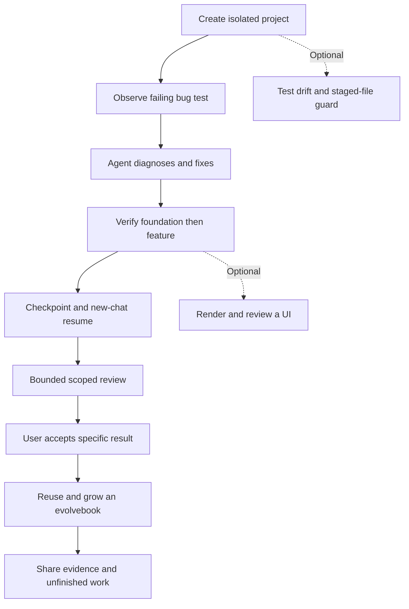

# Test moskills from A to Z

Want a concrete first project? Start with [Build something useful with moskills](quick-start.md).

This is a hands-on trial you can run alone, then share with the community. You will fix a small bug, build a small feature, resume work, review it, and try an evolvebook. Everything happens in a disposable folder.

Run one step at a time in a fresh terminal. Read each expected result before continuing. Stop at unexpected failures; the deliberately failing bug, repeat, drift, and guard checks are labeled below.

moskills supplies instructions, project files, helpers, and optional guards. Your coding agent follows the workflow. This release does **not** supply an enforced run engine, evidence database, progress dashboard, or evolvebook forms. Keep the evidence yourself; a confident answer is not a passing test.

Start with steps 1–9, then test evolvebooks in steps 11–12. Steps 10 and 13–15 are optional. Finish with the report and cleanup in step 16. The prompts are written for your agent; the commands are written for your terminal.

The 0.8.0 package passed all six [Linux/macOS CI jobs with Node 18, 22, and 24](https://github.com/Mouad1/moskills/actions/runs/38147935144). Installation, bug red/green, drift, guard, and evolvebook commands below were also checked in an isolated lab. Automatic loading, agent behavior, fresh-chat recovery, independent review, and visual checks remain your hands-on trial.

## 1. Check what you need

Use macOS, Linux, or Windows through WSL, with Node.js 18+, npm, Git, and a POSIX shell. You also need an existing coding agent and account. This guide adds no third-party project dependencies and changes no global npm installation.

**Commands**

```sh
node --version
npm --version
git --version
```

**Expected:** Node reports 18 or newer; all three commands work. Native Windows, live Claude Code, and other hosts need their own observed trials. Do not mark them verified because another host worked.

**Record:** pass / fail / unknown, plus your OS, Node version, and agent name. For every later step, record the same three statuses. Use `unknown` when you could not run the check; it never means pass. Optional steps can be skipped with a reason.



The solid path is the main trial. Dotted branches add checks when relevant. Acceptance is your decision; missing required evidence keeps work unfinished.

## 2. Make a disposable lab and pack the source

moskills 0.8.1 is published on npm. This walkthrough deliberately tests the merged repository source and its local tarball in an isolated lab. These commands use the actual source version, not a guessed package filename. Keep this terminal open so the variables remain available.

**Commands**

```sh
MOSKILLS_LAB=$(mktemp -d "${TMPDIR:-/tmp}/moskills-lab.XXXXXX")
export MOSKILLS_LAB
export npm_config_cache="$MOSKILLS_LAB/npm-cache"
export MOSKILLS_CACHE_DIR="$MOSKILLS_LAB/moskills-cache"
MOSKILLS_LAB_ORIGINAL_PATH=$PATH
export MOSKILLS_LAB_ORIGINAL_PATH
mkdir -p "$MOSKILLS_LAB/artifacts" "$MOSKILLS_LAB/project"
git clone --branch main https://github.com/Mouad1/moskills.git "$MOSKILLS_LAB/source"
cd "$MOSKILLS_LAB/source"
git rev-parse HEAD > "$MOSKILLS_LAB/source-commit.txt"
node -p "require('./package.json').version" > "$MOSKILLS_LAB/source-version.txt"
npm test
npm pack --ignore-scripts --cache "$MOSKILLS_LAB/npm-cache" \
  --pack-destination "$MOSKILLS_LAB/artifacts" --json > "$MOSKILLS_LAB/pack.json"
MOSKILLS_TARBALL=$(node -e \
  'const fs=require("node:fs"); const p=JSON.parse(fs.readFileSync(process.argv[1],"utf8")); console.log(p[0].filename)' \
  "$MOSKILLS_LAB/pack.json")
```

**Expected:** tests pass; one tarball appears under `artifacts`. Stop if `package.json` is absent or a check fails: the checked-out source is not ready for this installation path. Clone/pack creates no commit or publication.

**Record:** test result, source version, commit, and any failure. Do not claim support for platforms you have not used.

## 3. Install only inside the lab

**Commands**

```sh
npm install --prefix "$MOSKILLS_LAB/pkg" --ignore-scripts \
  --cache "$MOSKILLS_LAB/npm-cache" "$MOSKILLS_LAB/artifacts/$MOSKILLS_TARBALL"
MOSKILLS="$MOSKILLS_LAB/pkg/node_modules/.bin/moskills"
export MOSKILLS
cd "$MOSKILLS_LAB/project"
mkdir -p .evolvebooks
printf '%s\n' '{"home":".evolvebooks"}' > .evolvebooks.json
cat > .env.local <<'ENV'
export MOSKILLS="$PWD/../pkg/node_modules/.bin/moskills"
export PATH="$PWD/../pkg/node_modules/.bin:$PATH"
export npm_config_cache="$PWD/.npm-cache"
export MOSKILLS_CACHE_DIR="$PWD/.moskills-cache"
export MOSKILLS_NO_UPDATE_CHECK=1
export EVOLVEBOOKS_HOME="$PWD/.evolvebooks"
ENV
. ./.env.local
cp "$MOSKILLS_LAB/source-commit.txt" SOURCE-COMMIT.txt
cp "$MOSKILLS_LAB/source-version.txt" SOURCE-VERSION.txt
"$MOSKILLS" version
"$MOSKILLS" init
cat >> AGENTS.md <<'MD'

## Disposable trial environment
Before every shell call, change to this project and source ./.env.local.
Use the lab moskills CLI and scoped caches. Do not change global settings,
install dependencies, commit, push, publish, or deploy during this trial.
MD
"$MOSKILLS" doctor
```

**Expected:** initialization creates `AGENTS.md`, `CLAUDE.md`, copied project instructions, `.claude/STATE.md`, and `tasks/` notes. Doctor reports the project ready. No AI agent or subscription is installed.

The local evolvebook location and cache settings keep this trial separate from personal books and caches. `.env.local` selects the lab CLI and disables update-network checks for this trial. Source it only while inside the lab project. The appended trial boundary is project-owned text outside managed instructions; it configures isolation, not skill routing. GUI agents may not inherit terminal variables; step 4 requires each agent shell call to load it. Source metadata is copied into the project for your report.

**Record:** CLI version and doctor result. Restart a chat that already loaded old instructions.

`npx moskills@latest init` is available in a project folder. Keep this walkthrough on its local tarball path so its evidence refers to the source you tested.

## 4. Start the agent and keep a scorecard

Open **only** the lab's `project` folder in your agent. Copy its path from `pwd`. Keep user-facing evidence in `TEST-RESULTS.md`; use `tasks/todo.md` and `.claude/STATE.md` for the agent's progress.

Start a fresh chat. Test discovery before telling the agent to read any particular instruction file.

**First prompt**

> What is still not done in this project, and how would you approach a small bug fix? Do not change anything yet.

Then ask:

> Which instruction sources actually informed that answer? Name their paths and the loading or tool evidence already available. Distinguish startup-loaded instructions from files you opened afterward. Do not read additional files to fill a gap in this answer.

**Expected:** the host's instruction view or visible activity shows which sources loaded. Compare that evidence with the agent's answer. An agent saying “I loaded it” is not sufficient proof. If your host exposes no loading evidence, mark automatic loading `unknown`. Record ordinary workflow discovery separately: did it find the installed guidance without you naming it?

If discovery failed or remained unknown, use this **fallback prompt**:

> Read this project's AGENTS.md and installed moskills instructions explicitly. Report the actual files read. This is an explicit-read fallback; do not report it as proof of automatic loading.

Then give the same trial boundaries whichever path worked:

> This is a disposable trial. Work only in this project. For every shell call, first change to this project and source ./.env.local, then run the command. Use this lab’s moskills CLI, including for notice or evolvebook helpers; do not invoke another global copy. These settings scope npm/moskills caches and evolvebooks to the lab even when your host did not inherit terminal variables. Do not install dependencies, change global settings, commit, push, publish, or deploy. Route ordinary requests to the relevant workflow. Keep Finished and Still not done lists, with observed command results and next actions. Unknown required checks stay unfinished. Save this trial in TEST-RESULTS.md using the checklist below. Identify tools you can attempt to use; keep capability checks unknown until their use is observed.

**Record:** automatic loading, ordinary discovery, and explicit-read fallback each get a separate pass / fail / unknown result. Independent review, browser interaction, checkpoint recovery, and human approval remain unknown until their respective exercises demonstrate them.

Copy this starter into `TEST-RESULTS.md`, or ask the agent to save it. The saved Markdown file is your downloadable checklist; open it from your agent's file view and save a copy before cleanup. Move an item to Finished only after its required checks pass and any required acceptance is recorded. Keep failed and unknown items in Still not done.

```md
# My moskills trial
Source version / commit:
OS / Node / agent:

## Finished
- None yet.

## Still not done
- [ ] Local installation and health check — unknown
- [ ] Automatic instruction loading — unknown
- [ ] Ordinary workflow discovery — unknown
- [ ] Explicit-read fallback, if needed — unknown
- [ ] Bug: failing test observed, then passing test observed — unknown
- [ ] Pricing rules tested before basket feature — unknown
- [ ] New chat resumes saved progress — unknown
- [ ] Scoped review and any fixes — unknown
- [ ] User accepts this specific result — unknown
- [ ] Evolvebook creation, use, repeat check, and export — unknown
- [ ] Optional UI, growth, drift, and guard exercises — not attempted

## Evidence
| Check | pass / fail / unknown | What I observed | Next action |
| --- | --- | --- | --- |
| Installation | unknown | | Run version and doctor |

## Limits and confusing moments
- Other hosts/platforms: not tested.
- Optional exercises skipped: list each and why.
```

## 5. Give the agent a real failing test

Create a tiny pricing module using only Node's built-in test runner.

**Commands**

```sh
cat > package.json <<'JSON'
{"name":"moskills-lab","private":true,"scripts":{"test":"node --test"}}
JSON
cat > price.cjs <<'JS'
function discountedPrice(cents, percent) {
  return Math.round(cents * percent / 100);
}
module.exports = { discountedPrice };
JS
cat > price.test.cjs <<'JS'
const test = require('node:test');
const assert = require('node:assert/strict');
const { discountedPrice } = require('./price.cjs');
test('20% off 1000 cents leaves 800 cents', () => {
  assert.equal(discountedPrice(1000, 20), 800);
});
JS
npm test > bug-before.txt 2>&1
printf 'Exit: %s\n' "$?"
cat bug-before.txt
```

**Expected:** test fails with actual 200, expected 800, and a nonzero exit. This failure is intentional. If it passes, stop and inspect the fixture.

**Prompt**

> Fix the pricing bug. Reproduce it first, explain the cause briefly, make the smallest correct fix, and run the test. Preserve the expected behavior; do not weaken the test. Save before/after evidence. Do not commit.

**Expected:** diagnosis finds the discount amount was returned instead of the remaining price. The original test then passes. Run `npm test` yourself to confirm.

**Record:** red test and green test results separately. A passing rewritten assertion alone is not proof of the fix.

## 6. Test foundation-first feature work

**Prompt**

> Extend pricing safely. First agree on and test the discountedPrice contract: cents must be a nonnegative safe integer; percent must be finite and between 0 and 100; invalid inputs throw RangeError. Include zero, 100%, fractional percentages, and rounding. Once that foundation passes, add quote(items, percent), where each item has cents and quantity. Quantity must be a nonnegative safe integer. Sum line amounts, reject unsafe totals, apply the discount once, and return integer cents. A basket with two 500-cent items at 20% returns 800. An empty basket returns 0. Use no dependencies. Write a short plan and acceptance checks before implementation. Keep each layer's evidence. Do not commit.

**Expected:** the agent verifies the pricing contract before building the basket feature. Tests cover the stated examples and rejection cases. Routine implementation choices should not turn into repeated questions.

**Record:** foundation and feature separately, with actual commands/results. If behavior changes after a passing check, rerun affected checks and replace stale evidence.

## 7. Stop and resume in a new chat

**Prompt**

> Save a checkpoint now: goal, agreed contract, finished work with evidence, still not done, changed files, and next action. Leave this task open for review. Do not commit.

Close that chat. Open a fresh chat in the same lab project:

> Continue this project from its saved checkpoint. Read project instructions and progress files. Reconstruct Finished and Still not done. Verify current files match the checkpoint, then resume the earliest unfinished step. Do not rely on previous chat history. Do not commit.

**Expected:** the new chat recovers the contract and remaining review without asking you to retell the task. It rechecks any stale evidence instead of assuming it still applies.

**Record:** files used to resume, correct next action, and any lost decisions. A new chat is not a background scheduler or automatic wakeup.

## 8. Review one bounded scope

**Prompt**

> Review only price.cjs, price.test.cjs, and any quote files introduced by this feature. Look for reproducible correctness defects against our agreed contract. Use an independent reviewer if this host supports one; disclose when it does not. Then make at most two fix/re-review passes. Rerun affected tests after fixes. If blocking defects remain, stop looping and list them with next actions. Do not broaden scope or commit.

**Expected:** review reports concrete findings with locations and reproductions, or reports no findings within that scope. A host without independent review can perform a disclosed serial self-review. If independence is required for your trial, leave that requirement unknown until a human or supported reviewer completes it.

**Record:** reviewer type, scope, findings, number of passes, and final test result. A two-pass prompt is an instruction to the agent, not a runtime-enforced limit.

## 9. Make acceptance explicit

**Prompt**

> Present the exact result for my acceptance: agreed behavior, changed files, current verification evidence, review findings, and anything still unverified. Keep it short. Do not commit or push.

Inspect the code and run `npm test`. If satisfied, reply:

> I accept this pricing result as tested. Record my acceptance. This does not authorize a commit, push, merge, or deployment.

**Expected:** only the accepted scope moves to Finished. A task with an unresolved required failure or unknown check stays open. Acceptance does not silently authorize Git actions.

**Record:** your acceptance and the file version it covered, or why you withheld it.

## 10. Optional: preview and visually review a small UI

**Prompt**

> Create a local HTML price calculator with labeled price and discount inputs, a visible result, and clear invalid-input feedback. Reuse the verified pricing behavior. No dependencies. Use the installed preview workflow if available; otherwise make a Node built-in HTTP preview with explicit start/stop instructions. Show a draft before building if design approval is required. Review the rendered page at desktop and narrow widths, keyboard use, and errors. Save observed evidence. Do not claim visual checks you could not perform. Do not commit.

**Expected:** a working preview you can open locally. For example, `node server.cjs` may start the agent's local server; use its actual instructions and URL. In your browser, check 1000 cents at 20% → 800, 0% → unchanged, 100% → 0, and invalid inputs → clear feedback. Check labels, focus, and narrow-screen layout yourself.

**Record:** screenshots or observed checks, viewport widths, who reviewed the page, and server shutdown. If the agent lacks browser tools, your own rendered checks can supply evidence. Until either you or the agent actually checks the page, visual review remains unknown, even when Node tests pass. Skip this exercise if you want a backend-only trial; explain why visual review is not applicable to that scope.

## 11. Create an evolvebook only inside this project

An evolvebook is a reusable guide for one kind of job. This trial uses short testing notes, so a second run can vary without inventing another software feature.

The following setup tests project-only configuration **inside the lab** and confirms the location already scoped in step 3. The exported environment variable affects this terminal, not your permanent shell configuration.

**Commands**

```sh
cd "$MOSKILLS_LAB/project"
EVOLVEBOOKS_HOME= XDG_CONFIG_HOME="$MOSKILLS_LAB/config" \
  "$MOSKILLS" evolvebook setup --project-only
printf '%s\n' '{"home":".evolvebooks"}' > .evolvebooks.json
export EVOLVEBOOKS_HOME="$MOSKILLS_LAB/project/.evolvebooks"
"$MOSKILLS" evolvebook where
```

**Prompt**

> Create a project-only evolvebook named sandbox-note for short explanations of a verified coding exercise. Use only this project's .evolvebooks folder. For every helper call, set EVOLVEBOOKS_HOME to that folder if your agent did not inherit the terminal variable. No global links or configuration changes. Audience: a new community tester. Choices that can vary between runs: topic, audience, format. Brief: topic and audience from my request, format default walkthrough, maximum 150 words. Check: npm test must pass; a human checks accuracy and clarity. No examples or Never-list entries yet. Show one short summary and wait for my “ok” before creating it.

Review the summary, then reply `ok` when it matches. The agent should create it through the helper, equivalent to:

```sh
"$MOSKILLS" evolvebook new sandbox-note --project \
  --purpose "Explain a verified coding exercise" \
  --use-when "the user asks for a short coding test note" \
  --choices "topic,audience,format"
"$MOSKILLS" evolvebook list
```

Do not run `new` yourself if the agent already created it. The agent fills Brief, Choices, and Check; the generated files alone are not a complete guide.

**Expected:** the new book lives in `.evolvebooks/sandbox-note`; your approval precedes creation. `list` shows it. Nothing links into your personal agent folders.

**Record:** book path, creation approval, and a check of its Brief, Choices, and Check.

## 12. Use it, reject a repeated plan, and export it

**Prompt**

> Use sandbox-note to explain the discount bug fix. Choices: topic=discount, audience=beginner, format=walkthrough. I approve those brief answers. Run the repeat check before making the note, run the Check afterward, and save the note as discount-note.md. Record the completed run through the helper. Do not add an Example or Never rule without my explicit yes.

**Expected:** first repeat check passes because there are no past runs. The agent writes the note, observes `npm test`, asks for any human check required by the book, records a Done row, and asks whether to add an Example. You may say no.

**Commands**, after the run is recorded:

```sh
"$MOSKILLS" evolvebook repeat sandbox-note \
  topic=discount audience=beginner format=walkthrough
printf 'Repeat exit: %s\n' "$?"
"$MOSKILLS" evolvebook repeat sandbox-note \
  topic=limits audience=maintainer format=checklist
"$MOSKILLS" evolvebook list
"$MOSKILLS" evolvebook export sandbox-note --out sandbox-note-export.md
```

**Expected:** identical choices fail with exit 1. The changed plan passes because at least two of three choices differ. Export creates a self-contained Markdown file. The repeat check compares choices; it does not judge whether content is good or tests really ran. Never change the Done list to make a repeated plan pass.

**Record:** both repeat outcomes, Done-row count, and export path. Optionally use the changed choices in a second ordinary-language request and check the run count increases.

## 13. Optional: approve specific growth

Inspect the note first. Running these commands is explicit approval for these sample entries; skip them if you do not want those rules saved. All sample content is synthetic and local.

**Commands**

```sh
"$MOSKILLS" evolvebook example sandbox-note --verdict good \
  --title "Discount explanation" --why "States the cause and observed test result" \
  --where discount-note.md
"$MOSKILLS" evolvebook mistake sandbox-note --title "Missing observed check" \
  --context "Review of a trial note" --mistake "A draft claimed a check without output" \
  --rule "Include observed command results before saying a check passed"
"$MOSKILLS" evolvebook mistake sandbox-note --title "Missing observed check"
"$MOSKILLS" evolvebook suggest sandbox-note
```

**Expected:** one approved Example; the same Mistake reaches `Seen: 2`; `suggest` proposes promotion. It must not promote automatically. To approve this specific Never rule:

```sh
"$MOSKILLS" evolvebook never sandbox-note \
  --never "Claim a check passed without observing it" \
  --instead "Run the check and include its actual result" \
  --from-mistake "Missing observed check"
"$MOSKILLS" evolvebook suggest sandbox-note
"$MOSKILLS" evolvebook export sandbox-note --out sandbox-note-export.md
```

**Expected:** the approved rule has an Instead; that mistake is no longer proposed for promotion. Helper additions and export scan for obvious secrets, but still inspect the export yourself before sharing. Never paste real credentials or private material into this exercise.

**Record:** approvals, counts, and promotion result. These are intentional sample entries, not evidence that a real mistake occurred.

## 14. Optional: prove reruns preserve edits and doctor finds drift

This deliberately changes **one managed copy in the disposable lab**. Keep personal project rules outside managed blocks.

**Commands**

```sh
cp .agents/skills/diagnose/SKILL.md "$MOSKILLS_LAB/diagnose-before.md"
printf '\nTrial managed edit.\n' >> .agents/skills/diagnose/SKILL.md
"$MOSKILLS" doctor
printf 'Doctor exit: %s\n' "$?"
"$MOSKILLS" init
"$MOSKILLS" sync
node -e 'const fs=require("node:fs"); if (!fs.readFileSync(process.argv[1],"utf8").includes("Trial managed edit.")) process.exit(1)' \
  .agents/skills/diagnose/SKILL.md
"$MOSKILLS" doctor
printf 'Preserved-drift exit: %s\n' "$?"
```

**Expected:** doctor reports drift and exits nonzero; ordinary init/sync preserve the edit and warn. The Node check succeeds; drift stays visible.

If you approve restoring **all managed copies in this lab** from the installed package, run:

```sh
"$MOSKILLS" sync --force
"$MOSKILLS" doctor
```

**Expected:** doctor passes after restoration; project-owned progress notes remain. `--force` replaces managed edits, so do not carry this exercise into a real project casually. The backup remains in the lab.

**Record:** detected drift, preservation, explicit force decision, and final doctor result.

## 15. Optional: test the staged-file guard without committing

**Commands**, inside the lab project:

```sh
git init --template=
git config --local core.hooksPath .git/hooks
"$MOSKILLS" init --with-hooks
printf '%s\n' 'TODO: implement later' > guard-demo.txt
git add guard-demo.txt
sh .git/hooks/pre-commit
printf 'Guard exit: %s\n' "$?"
printf '%s\n' 'Demonstration complete.' > guard-demo.txt
git add guard-demo.txt
sh .git/hooks/pre-commit
printf 'Clean guard exit: %s\n' "$?"
git rm --cached guard-demo.txt
rm guard-demo.txt
```

**Expected:** the staged placeholder is rejected with exit 1; clean content passes. Nothing is committed or pushed. The guard examines staged content and suggests tests; it does not run all tests or enforce acceptance.

The empty Git template and repository-local hook path keep this exercise separate from personal hooks and global Git configuration.

**Record:** both exit results and the absence of commits. If a hook already exists, the installer preserves it; inspect and record that outcome instead of overwriting it.

## 16. Share results, then clean up

**Prompt**

> Finish TEST-RESULTS.md for a community tester. Include source version and commit, OS/Node/agent, whether instructions loaded automatically, each observed check with pass/fail/unknown, review scope and limits, Finished and Still not done, confusing moments, and exact reproduction steps for failures. Include one useful Mermaid diagram. Do not include credentials, personal paths, or private chat history. Do not call skipped or unknown checks passed.

**Expected:** someone else can reproduce your result without your agent setup. Review the report and exported evolvebook before sharing. Share the document yourself, or explicitly authorize your agent to publish it.

A finished code exercise can still have publication, other hosts, or optional trials unfinished. Report both lists honestly. Accepting this lab result does not authorize a repository commit.

When finished, stop any preview server first. Copy the report/export somewhere you want to keep them. Close the agent chat, then run:

```sh
cd "${TMPDIR:-/tmp}"
case "$MOSKILLS_LAB" in
  "${TMPDIR:-/tmp}"/moskills-lab.*) rm -rf -- "$MOSKILLS_LAB" ;;
  *) printf '%s\n' 'Unexpected lab path; nothing removed.' ;;
esac
PATH=$MOSKILLS_LAB_ORIGINAL_PATH
export PATH
unset MOSKILLS_LAB MOSKILLS MOSKILLS_TARBALL EVOLVEBOOKS_HOME \
  npm_config_cache MOSKILLS_CACHE_DIR MOSKILLS_NO_UPDATE_CHECK MOSKILLS_LAB_ORIGINAL_PATH
```

**Expected:** only the lab, its package prefix, cache, and test project disappear. Existing global moskills installations stay untouched. No global npm uninstall is needed.

**Record:** saved report/export location and cleanup result. Keep unfinished findings in the report so the next tester knows what remains.

Related guides: [npm installation](npm-installation.md), [architecture and roadmap](architecture.md), and [evolvebooks](evolvebook.md).
