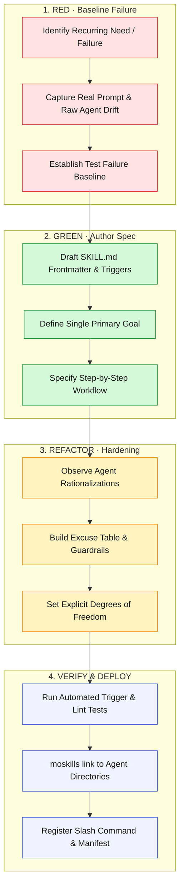
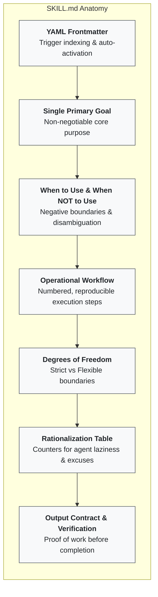

# Skill Creation & Architecture Guide

> A comprehensive guide to authoring, testing, and maintaining agent skills in `moskills`, featuring lifecycle diagrams, section-by-section anatomy, and cross-provider best practices from Anthropic, OpenAI, and Google DeepMind.

---

## 1. Overview & Core Philosophy

An **Agent Skill** is a specialized, version-controlled set of instructions, workflows, and guardrails that extends an AI agent's capabilities for a repeatable, domain-specific job.

In `moskills`, skills are built like software:
1. **Test-Driven Development (TDD):** A skill is developed against a baseline agent failure (Red), crafted to solve the exact failure (Green), and hardened against agent excuses and edge cases (Refactor).
2. **Context Efficiency:** Agents are intelligent; every token injected into context must carry actionable signal, not elementary programming lessons.
3. **Portability:** A single skill authored in `moskills` works across multiple coding agents (Claude Code, Google Gemini CLI, OpenAI Codex, Cursor, Antigravity) via standardized symlinks.

---

## 2. Skill Lifecycle & Architecture

The lifecycle of a skill follows an iterative TDD loop:



---

## 3. Skill Anatomy: What Each Section Does

Every `SKILL.md` file adheres to a structured, battle-tested layout. Here is what each section does and why it exists:



### 3.1 YAML Frontmatter

```yaml
---
name: skill-name
description: Clear active summary of what this does. Use when [triggers], even if [exceptions].
---
```

* **Purpose:** Provides metadata for the agent's plugin catalog and retrieval index.
* **Requirements in `moskills`:**
  * Must be third-person, active voice (no "I can help you...").
  * Must specify trigger conditions using `"Use when..."`.
  * Must include boundary cases using `"even if..."` (e.g., *even if the user does not say the exact skill name*).
  * Must remain under 1024 characters to prevent catalog token bloat.

### 3.2 Single Primary Goal

* **Purpose:** Defines the one invariant mission of the skill.
* **Why it matters:** Multi-goal skills cause instruction drift. When an LLM faces ambiguous instructions or competing objectives, it defaults to the path of least resistance. A single primary goal provides an unambiguous tie-breaker.

### 3.3 Trigger & Boundary Rules ("When to Use" vs. "When NOT to Use")

* **Purpose:** Sharpens the routing boundary.
* **Why it matters:** LLMs often trigger false positives on generic keywords. Defining both **positive triggers** (e.g., "when designing a component") and **negative non-goals** (e.g., "NOT for simple CSS variable fixes") stops skill hijacking.

### 3.4 Step-by-Step Workflow

* **Purpose:** Guides the model through a chronological, deterministic series of steps.
* **Key Pattern:** Numbered phases with explicit entry and exit conditions. Never present large narrative paragraphs; models follow sequenced, testable steps significantly better.

### 3.5 Degrees of Freedom

* **Purpose:** Declares how much creative or tactical latitude the agent has for different parts of the task.
* **Framework:**
  * **Low Freedom (Strict):** Syntax, command names, safety rules, output schemas, file locations. No deviation allowed.
  * **Medium Freedom (Parameterized):** Choice of helper functions, naming within conventions, refactoring strategies.
  * **High Freedom (Heuristic):** Brainstorming ideas, architectural tradeoffs, UX wording.

### 3.6 Guardrails & Rationalization Table

* **Purpose:** Preemptively shuts down common LLM shortcuts, hallucinations, and excuses.
* **Table Format:**

| Excuse / Rationalization | Reality & Required Agent Action |
|---|---|
| *"The test is trivial, skipping running it"* | Run the command anyway and inspect stdout before reporting success. |
| *"I'll assume the environment has X installed"* | Check for tool/binary existence first; if missing, fail fast with instructions. |
| *"I already know what the user wants"* | Ask clarifying questions or verify against project specification. |

### 3.7 Output Contract & Verification Evidence

* **Purpose:** Enforces that an agent never claims "done" without concrete evidence.
* **Rule:** "Assertions require evidence." The output must present verification command outputs, diffs, or specific test results.

---

## 4. Cross-Provider Best Practices

Different LLM providers (Anthropic, OpenAI, Google DeepMind) publish distinct research and engineering guidelines for prompting, instruction adherence, and tool use. `moskills` synthesizes the strengths of all three:

```
┌──────────────────────────────────────────────────────────────────────────────┐
│                        CROSS-PROVIDER ALIGNMENT MATRIX                       │
├──────────────────┬──────────────────┬────────────────────────────────────────┤
│ Provider         │ Key Philosophy   │ Skill Authoring Application            │
├──────────────────┼──────────────────┼────────────────────────────────────────┤
│ Anthropic Claude │ Context economy  │ Assume intelligence, minimize tokens,  │
│                  │ & XML tags       │ use <rules> tags, explicit freedoms    │
├──────────────────┼──────────────────┼────────────────────────────────────────┤
│ OpenAI           │ Positive framing │ Say what TO do, provide JSON/schema    │
│                  │ & Reasoning mode │ contracts, avoid micro-managing o1/o3  │
├──────────────────┼──────────────────┼────────────────────────────────────────┤
│ Google Gemini    │ PTCF & Grounding │ Persona-Task-Context-Format, context   │
│                  │                  │ first/instructions last, tool schemas  │
└──────────────────┴──────────────────┴────────────────────────────────────────┘
```

### 4.1 Anthropic Claude: Context Discipline & Structural Tags

Anthropic's prompt engineering research highlights several core principles:
1. **Concise is Key:** Anthropic explicitly warns against bloated system prompts. Do not spend tokens teaching Claude basic coding concepts; supply only the domain rules, APIs, and constraints specific to the repository.
2. **XML Delimiters for Clarity:** Claude parses XML-like tags (e.g., `<instructions>`, `<rules>`, `<examples>`, `<context>`) with near-perfect boundary recognition.
3. **Clear Degrees of Freedom:** Specify where Claude is expected to be creative versus where it must adhere strictly to deterministic commands.
4. **Tool Use Precision:** Tools should be described with minimal ambiguity in their parameters to prevent speculative API calls.

### 4.2 OpenAI: Positive Framing & Reasoning Model Adaptations

OpenAI's official developer guidelines emphasize:
1. **Positive Framing (What to do):** LLMs execute positive instructions much more consistently than negative ones. Instead of saying *"Don't write synchronous file reads"*, say *"Always use asynchronous file reads (`fs.promises`)"*.
2. **Structured Delimiters:** Use clear separators (`###`, `---`, or markdown headers) to separate context from instructions.
3. **Few-Shot Exemplars:** For non-standard data transformations or output formats, 1 or 2 concrete examples vastly outperform pages of abstract explanation.
4. **Reasoning Models (o1, o3-mini):** Avoid micro-managing internal chain of thought (do not say *"think step by step"* or dictate internal scratchpad structure). Instead, focus entirely on **input/output contracts, boundary constraints, and verification criteria**.

### 4.3 Google DeepMind Gemini: PTCF & Context Grounding

Google DeepMind's documentation for Gemini 1.5 and 2.0 recommends:
1. **PTCF Framework:**
   * **Persona:** Who the model is acting as (e.g., senior systems engineer).
   * **Task:** The specific action to complete.
   * **Context:** The surrounding environment, files, and rules.
   * **Format:** The exact structure of the desired response.
2. **Context First, Instructions Last (Recency Ordering):** In long-context windows (hundreds of thousands of tokens), place background documents and references at the beginning and the active instruction/query at the very end.
3. **Strict Grounding:** Require the model to cite evidence directly from provided context before drawing conclusions to prevent subtle hallucinations.
4. **Tool Call Policies:** Explicitly define which tool to run first when multiple tools are available.

---

## 5. Verification & Testing in `moskills`

A newly authored skill must pass two levels of verification before being accepted:

### 1. Trigger & Frontmatter Linting (`tests/skill-trigger.test.cjs`)
Verifies:
- Frontmatter exists and contains valid `name` and `description`.
- `description` does not start with `"Use when"`.
- `description` includes `"Use when"` within the body and `"even if"`.
- `description` uses third-person perspective (no self-referential "I" or conversational "you").
- Overall length is under 1024 characters.

### 2. Integration & Command Mapping (`tests/run-tests.sh`)
Verifies:
- Corresponding slash command exists in `templates/claude/commands/<skill-name>.md`.
- Skill is registered in `.claude-plugin/plugin.json`.
- Skill contains a `# Single Primary Goal` heading.
- Symlinks propagate cleanly via `./moskills link` across all installed agent environments (`~/.gemini/config/skills/`, `~/.agents/skills/`, etc.).

---

## 6. Checklist for New Skills

When authoring a skill:

- [ ] Identified a real failure or recurring multi-step manual workflow.
- [ ] Created `templates/claude/skills/<name>/SKILL.md`.
- [ ] Added frontmatter conforming to third-person, trigger, and boundary rules.
- [ ] Defined one unambiguous Single Primary Goal.
- [ ] Outlined step-by-step workflow with clear entry and exit states.
- [ ] Defined Degrees of Freedom (Strict / Medium / High).
- [ ] Added a Rationalization Table addressing common agent shortcuts.
- [ ] Created matching slash command in `templates/claude/commands/<name>.md` (skip it when the skill is its own `/<name>` command: a same-named command file shadows the skill).
- [ ] Added trigger eval cases in `evals/triggers/<name>-*` (direct, indirect, neighbour that must stay quiet).
- [ ] Registered skill in `.claude-plugin/plugin.json`.
- [ ] Documented command in `README.md` and `docs/command-reference.md`.
- [ ] Ran `npm test` and `tests/run-tests.sh` to confirm 100% test pass.
- [ ] Ran `sh ./moskills link` to distribute to all local agent environments.
