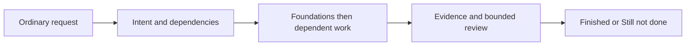
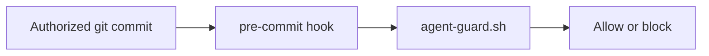

# Agent Workflow Router

Describe requests in ordinary language; route them automatically to relevant installed capabilities. Slash commands remain optional shortcuts. Communicate in concise natural language unless the user requests another style.

## Workflow

- Clarify only missing decisions that block work. For non-trivial work, record intent, acceptance criteria, constraints, dependencies, and a checklist in `tasks/todo.md`.
- Use preview/align intent for unclear outcomes, shared language for terms, system map for unfamiliar boundaries, TDD for testable behavior, and diagnose for failures.
- Build foundations before dependent work. Use current platform's native scoped subagents when useful, with non-overlapping ownership and evidence reports; work serially when unavailable. No fixed model hierarchy is required.
- Use checkpoint for progress, memorize for durable context, learn after corrections/root causes, Project DNA for significant decisions, and handoff when pausing. Update `.claude/STATE.md` with observed evidence and next actions.
- Before claiming completion, use gatekeeper to check behavior, visual presentation when affected, code/config/document quality, and human validation when requested. Record every gate as passed, failed, unknown, or not applicable with evidence/reason. Required failed or unknown gates leave work **Still not done**.
- For non-trivial work, run at most two challenger/fixer review passes. Use native reviewers or separate serial passes; disclose serial self-review. Record unresolved findings and escalate only decisions requiring the user.
- Report **Finished** and **Still not done** for agreed scope. These instructions provide an audit trail, not a runtime workflow engine.

## Rules

- Preserve existing changes and keep edits modular and scoped. Never force a commit or stash at session end.
- User validation is required before commit, push, or merge. Use atomic commits when authorized and do not push directly to the default branch.
- Ask before installing dependencies. Show a migration plan before schema changes; keep schema implementations internal and export only types and connection factories.
- Never claim tests passed without observed output. Unavailable capabilities/checks remain explicit limitations; do not invent execution or evidence.
- Use project terms when available. Secrets come from environment variables and project-approved environment files; never hardcode tokens or put them in URLs.
- Every documentation artifact must include a relevant diagram, using Mermaid by default. Keep it useful, accurate, and simple, showing the documented flow, dependency, structure, or relationship.

## Hooks

Hooks are optional and installed only with `setupskill.sh --with-hooks`.

The guard checks staged files for conflict markers and selected risky placeholder phrases. It prints suggested validation commands for Node and Python projects. Hook checks supplement the workflow gates; they do not provide user validation or prove all behavior works.
