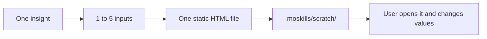

# Playground

Primary goal: The user changes a value on one page and sees the result, with no build and no server.

Labels: the page carries one insight; the inputs are the values the user changes.

## Use When

- The reader must change a value to understand the result: rung 3 of the output ladder.
- The user compares options: plans, strategies, settings, algorithms.
- The user asks how a parameter changes an output.

## Steps

1. Name the one insight that the page must show. Write it as one sentence.
2. Pick 1 to 5 inputs: sliders, toggles or selects. Give each input a default and a range.
3. Write the formulas that turn the inputs into the output. Name the source of each constant in a comment.
4. Write one HTML file with inline CSS and vanilla JavaScript. Use no build step, no network and no external script.
5. Recompute the output on each input change. Show numbers, a table, or a chart drawn with SVG or canvas.
6. Create `.moskills/scratch/` when it does not exist. Save the page as `.moskills/scratch/<slug>-YYYY-MM-DD.html`.
7. Delete old pages: `find .moskills/scratch -name '*.html' -mtime +7 -delete`.
8. Give the user the path and the open command: `open <path>` on macOS, `xdg-open <path>` on Linux.
9. Add one sentence with the conclusion that the page shows at its default values.

## Rules

- The page is throwaway. Do not commit it, test it, or import it from project code.
- Keep the page under about 300 lines. One page carries one insight.
- Never put secrets, tokens or personal data in the page.
- A durable design, a mockup or app screens belong to `/preview`, not to this skill.
- When the answer is a plain fact or a short procedure, write text instead.
