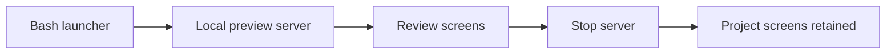

# Preview

Primary goal: Turn an unclear idea into a concrete spec before implementation. Respect design decisions and authorization already supplied by the user; do not reopen settled scope.

## Size the work

Once you understand what the user wants, name a size in plain words. The user can override it. If the work grows mid-task, stop, say so, and move up a size.

| Size | Where the description lives | Then |
| --- | --- | --- |
| Quick, clear task | the request itself | do it; no spec |
| Small change | a short description in chat, approved in chat | build it through the normal workflow |
| Project | a written spec in `docs/specs/` | builder check, user approval, then the plan |

If the request is really several independent projects, say so, agree on an order, and preview them one at a time.

## Conversation

- Ask one question per message, as a single plain sentence. Match the user's words; never use process jargon.
- Start open: ask about a real moment ("the last time you...") so the user describes the need in their own words. Offer a short menu only when they are stuck; when they say "you decide", propose something concrete.
- Find out early which choices the user wants to make (platform, language, tools) and which they hand to you. Choices you make go in the spec as your call.
- Ask the question that exposes risk: "What would make you wince if I got this wrong?"
- Play back as you go: once one part is clear, describe it back in a short paragraph, then move to the next part. Mark guesses as guesses and end each playback by asking what is wrong or missing.
- Think of several approaches privately; show a comparison only when it helps the user decide.

## Steps

1. **Explore context** — read project files, docs, recent commits. If `design.md` exists, read it: mockups use its tokens, shell, and components, and choices the user makes in the Visual Companion are written back into it (see the `design-system` skill). Do not keep a second set of design values in the spec.
2. **Size the work** — use the table above. Quick tasks and small changes skip steps 6 and 7.
3. **Detect frontend** — check rules below; start Visual Companion if triggered.
4. **Resolve missing decisions** — follow the Conversation rules. When the user says "you decide", resolve remaining choices, label them `Self-authored under delegation`, and do not re-ask. Infer routine choices from context.
5. **Write a concrete design** — save a concise spec to `docs/specs/YYYY-MM-DD-<topic>.md`; do not commit automatically.
6. **Builder check** — before showing the spec, give it to a fresh subagent with the prompt in `builder-check.md` (next to this file). Tell the user a reviewer reads it first and you may come back once with a few questions. Sort what comes back into the three piles the prompt defines: put already-answered points into the spec, settle builder-can-decide points yourself and mark them as your call, and bring only the user's-call points to the user, in one message, most important first. Without a subagent tool, read the spec yourself as that builder and record the limitation.
7. **Self-review spec** — fix placeholders, contradictions, ambiguity, and scope creep inline.
8. **Confirm only missing design approval** — if user authorization does not yet cover this design, present one concrete spec with the short list of calls you made, and ask once before implementation. Do not seek per-section approval or a second approval for the same design.
9. **Hand back** — record the spec path under Agreed scope in `tasks/todo.md`. Apply align-intent only if consequential intent remains unresolved; otherwise continue to the plan within the approved scope. No slash command is required from the user.

## Visual Companion

Requires Node.js and Bash. Scripts are bundled in `.claude/skills/preview/scripts/` — no external plugin needed. If Node.js, Bash, or the scripts are unavailable, record the limitation and use an available visual preview; ask before installing dependencies.



### When to auto-start (no consent)

**Start automatically when ANY is true:**

- Project has: `*.component.ts`, `*.html`, `*.css`, `*.scss`, `angular.json`, `tailwind.config.*`, or `package.json` with Angular / React / Vue dependency
- Working directory has: `src/app/`, `src/pages/`, `src/components/`
- Request mentions: UI, page, component, layout, design, mockup, wireframe, dashboard, form, navigation, theme, interface, frontend

For pure backend / CLI / infra: offer once with consent, do not auto-start.

### Session resume — check BEFORE starting a new server

```bash
# 1. Find existing session
SERVER_INFO_PATH=$(find .preview/ -name "server-info" 2>/dev/null | sort -r | head -1)
```

If found:

```bash
# 2. Read port
PORT=$(grep -o '"port":[0-9]*' "$SERVER_INFO_PATH" | grep -o '[0-9]*')

# 3. Check liveness
curl -s --max-time 2 "http://localhost:${PORT}/health" || echo "dead"
```

- **Alive** → resume. Parse `screen_dir` and `state_dir` from the same JSON. List `$SCREEN_DIR/*.html` sorted by mtime. Tell user: `"Active session at http://localhost:<port>. Previous mockups: [list]"`. Read `$STATE_DIR/events` to restore context.
- **Dead but file exists** → restart (mockups preserved in `.preview/`):
  ```bash
  bash .claude/skills/preview/scripts/start-server.sh --project-dir "$(pwd)"
  ```
  Then show summary.
- **No file found** → start fresh.

### Start server (fresh)

```bash
bash .claude/skills/preview/scripts/start-server.sh --project-dir "$(pwd)"
# Returns JSON: {"port":52341,"url":"http://localhost:52341",
#   "screen_dir":"<project>/.preview/<id>/content",
#   "state_dir":"<project>/.preview/<id>/state"}
```

Save `screen_dir` and `state_dir`. Tell user to open the URL.

### Write a mockup

Write an HTML fragment (not a full document) to `$SCREEN_DIR/<n>.html`. The server wraps it with chrome and reloads the browser automatically.

```html
<!-- example fragment -->
<div style="display:flex;gap:24px;padding:24px">
  <div class="option" data-choice="A" onclick="toggleSelect(this)">
    <div class="letter">A</div>
    <div class="content"><h3>Side panel</h3><p>Nav on left, content right.</p></div>
  </div>
  <div class="option" data-choice="B" onclick="toggleSelect(this)">
    <div class="letter">B</div>
    <div class="content"><h3>Full-width</h3><p>Top nav, full content below.</p></div>
  </div>
</div>
```

Only write a full `<!DOCTYPE html>` document when complete control over the page is required.

### Read user selections

```bash
cat "$STATE_DIR/events" 2>/dev/null | tail -5
```

### Stop server when done

```bash
# SESSION_DIR is the parent of state_dir
SESSION_DIR=$(dirname "$STATE_DIR")
bash .claude/skills/preview/scripts/stop-server.sh "$SESSION_DIR"
```

### Per-question rule

Active server ≠ use browser for everything. For each question: would the user understand this better by seeing it?

- **Browser**: mockups, layout comparisons, architecture diagrams, side-by-side previews
- **Terminal**: requirements questions, tradeoff lists, conceptual choices, scope decisions

"What personality should it have?" → terminal. "Which of these layouts feels right?" → browser.

## Spec Format

Include a relevant, simple diagram in every spec; use Mermaid by default to explain its flow, structure, or dependencies.

```text
Date:
Topic:
Chosen Approach:
Architecture:
Components:
Data Flow:
Error Handling:
Testing:
Non-goals:
Open Questions:
```

## STATE.md Update

After the design is settled, append to `.claude/STATE.md` under `Checkpoints` (do not create a duplicate history):

```text
Date:
Spec: docs/specs/YYYY-MM-DD-<topic>.md
Approach:
Non-goals:
```

## Rules

- Keep communication concise; ask only necessary questions.
- Complete the spec before implementation; do not add an approval stop when the design is already authorized.
- Never batch unrelated concerns into one spec.
- YAGNI: cut any feature not needed for the stated goal.
- Do not propose unrelated refactors.
- Fix spec issues inline. One builder check per spec; no further review cycles.
- Preserve existing authorization. Never commit, push, or merge without user validation; spec creation alone does not authorize these actions.
- If scope spans multiple independent subsystems, decompose first; run one sub-project through preview at a time.
- Stop the Visual Companion server when the brainstorming session ends.
