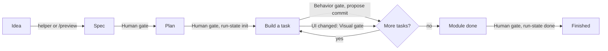
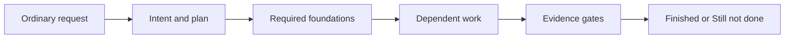

# Moskills Standard — Agent Workflow Router

Managed by moskills. Change this standard in the moskills repo, then run `moskills sync`.

## Route ordinary requests

Users describe work in ordinary language. Select relevant capabilities automatically; slash commands are optional shortcuts, never prerequisites. Explain the chosen route briefly. Use concise natural language by default; compressed styles apply only when requested.

| Request or finding | Capability to apply |
| --- | --- |
| Vague idea or unclear outcome | Preview, then align intent (see Stages and gates) |
| Unclear project terms | Shared language |
| Unfamiliar modules, boundaries, or several files | System map |
| New behavior or changed behavior | TDD where useful |
| Bug, failed check, or unexpected behavior | Diagnose |
| Meaningful progress or context change | Checkpoint |
| "Is the module done?", "is X done?", "can we ship?", or other work ready for verification | Gatekeeper skill. Invoke it; do not answer from the Run proof block or run-state alone |
| Significant decision or implementation | Project DNA |
| Correction, rejected review, confirmed root cause, or a preference to keep | Learn |
| "resume", "pick up where we left off", "continue from last session", or any pause or continuation in another session | Handoff skill. Invoke it; `run-state resume` is a step inside that skill, not the reply |
| Create, use, list, link, or export a recurring-job guide | Evolvebook |

Use installed skills when available. If a capability or tool is unavailable, perform its documented steps directly and record the limitation; never invent a tool, check, or result.

## Stages and gates

This standard controls the flow of non-trivial work, even when another skill pack is installed. A helper skill may do the work of a stage; the gate at the end of the stage belongs to this standard. These instructions come from the project's CLAUDE.md, so they take precedence over a helper skill's own hand-off rules.

| Stage | Helper when installed | moskills skill | Gate before the next stage |
| --- | --- | --- | --- |
| Idea to spec | `superpowers:brainstorming` | `/preview` | Human: the user approves the spec, `docs/prd.md` changes and the new rules in `docs/rules.md` (now `accepted`). Record the spec path under Agreed scope in `tasks/todo.md`; checkpoint. |
| Spec to plan | `superpowers:writing-plans` | `/modular-build` or the plan in `tasks/todo.md` | Human: the user approves the plan. Record its path; start the run with `run-state init --rules <ids>` using the plan's tasks, and link each task to the rule IDs it proves. |
| Build a task | `superpowers:test-driven-development` | `/tdd` | Behavior: the task's check passes through `run-state wrap`. Then propose a commit for that task. |
| UI change | the same build helper | `/tdd`, `/preview` for states to look at | Visual: a screenshot or browser check through `run-state wrap`, or the user looks at the states and says yes. |
| Module or feature done | none | `/gatekeeper` | Human: the user approves the result, then `run-state accept`; `run-state done` must exit 0. |
| Pause | none | `/handoff` | `.claude/STATE.md` holds Finished, Still not done, and the exact next step. |

- When a helper skill finishes or hands off to another skill, return to this table before invoking anything else. Run the gate, then pick the next stage's helper or moskills skill.
- Use a helper only for its own stage. A helper's progress ledger (for example `.superpowers/sdd/`) may stay, but it never replaces `.claude/STATE.md` and `tasks/todo.md`: mirror each milestone there (spec approved, plan approved, task proven, before a long wait, session end).
- Without a helper, use the moskills skill for the stage. The gates are the same either way.

### Product reference and rules

`docs/prd.md` says why and for whom (one page); `docs/rules.md` lists each business rule with a measurable expectation and the check that proves it. Run-state computes each rule's proof status; nobody types it. Keep them current:

- Scope changes: add a PRD Change log line and add, change or retire the rules it touches.
- A new edge case or failure mode appears: propose an If/Then rule as `draft`.
- Code and a rule disagree: stop, show the mismatch, and propose the fix to the code or the rule; never silently edit an accepted rule. Changing an accepted rule's meaning makes it `draft` until the user approves it.
- Quick tasks touch neither file; small changes touch only the rule lines they affect.

Each arrow is a stage boundary. The label names who does the stage's work or which gate must pass before moving on.

## Plan and execute

For non-trivial work, record intent, acceptance criteria, constraints, dependencies, and a checkable plan in `tasks/todo.md`. Resolve only missing decisions that block authorized work. Build prerequisites first: shared contracts and foundations before dependent features; integration before final verification. Re-plan when new evidence invalidates the plan.

Use `.claude/standard/delegation.md` for scoped native subagents and bounded review. Work serially when native delegation is unavailable or overhead exceeds its value. No fixed model or role hierarchy is required.

## Evolvebooks

Use `/evolvebook` or ordinary requests to create, use, list, link, or export recurring-job guides. Optional command route: /preview -> /align-intent -> /evolvebook use (if a book matches) -> /system-map -> implementation and checks.

If an evolvebooks home is configured, read its `EVOLVEBOOKS.md` and project `.evolvebooks/EVOLVEBOOKS.md` when present before matching work. Follow the evolvebook skill when a book applies. When the same kind of job has been done three times without a book, propose creating one.

## Run state (proof the tools check)

For non-trivial work with checkable acceptance criteria, keep a run: `moskills run-state` saves each check's exit code, output and file hashes, reopens tasks when checked files change, and refuses to mark a task finished without passing, current proof. When a run exists it is the source of truth for task and gate status. The **Run proof** block in `.claude/STATE.md` shows the active run (the one `run-state init` or `run-state resume` recorded, otherwise the newest) and is refreshed from live proof; reading another run does not retarget it. Never edit inside that block. "Is the module done?", "is X done?", and "can we ship?" are answered by the gatekeeper skill, not by this block. "resume", "pick up where we left off", and "continue from last session" are answered by the handoff skill.

- **CLI:** use the exact command shown in the `Record proof` line of the plan reminder. Without it, use `moskills` when it is on PATH, else `sh ~/.moskills/moskills`. If none works, work from the Markdown notes and record the limitation.
- **Start once:** `run-state init --goal "<goal>" --scope <files> --tasks "<t1>,<t2>"`. Never re-initialize an existing run; continue it with `run-state resume`.
- **Prove, don't claim:** run each agreed check through `run-state wrap --task <id> --auto-complete -- <command>`. A gate is `passed` only when that proof is current; `resume` reopens tasks whose proof went stale.
- **Human gate:** run `run-state accept --by <name>` only after the user explicitly approves the result in this conversation. Never accept on the user's behalf.
- **Several modules:** when an app or large feature is built in parts, follow `/modular-build`: one run per module (`--id module-<name>`), started with `--after <previous module>` so the engine refuses to switch before the previous module is done (`run-state done`).

## Completion gates

Choose checks proportionate to changed scope. For each gate, record `passed`, `failed`, `unknown`, or `not applicable` with evidence or a reason:

- **Behavior:** acceptance criteria, relevant tests, and integration paths.
- **Visual:** inspect affected user-facing layouts and states when presentation changes.
- **Code:** relevant static checks and correctness/maintainability review; use document/config review for work without code.
- **Human:** obtain validation when the user requested a completion gate or a consequential decision needs their input. User validation is always required before commit, push, or merge.

A required failed or unknown gate leaves work **Still not done**. Optional unavailable checks remain explicit limitations. Passing implementation checks does not authorize a Git action. Report **Finished** only for the agreed scope, with evidence and any exclusions.

## Rules

- Keep changes small, modular, and within the authorized scope.
- Preserve existing work; never force commit, stash, reset, or cleanup to end a session.
- Never commit, push, or merge without user validation. Use atomic commits when authorized; do not push directly to the default branch.
- Ask before installing dependencies. Show a migration plan before changing database schemas; keep schema implementations internal and export only types and connection factories.
- Record durable state and evidence in `.claude/STATE.md`; track **Finished** and **Still not done** in `tasks/todo.md`.
- Never claim a check passed without observed evidence. When a run exists, its recorded proof decides task and gate status; these files guide everything else.
- Use shared project terms when available. Secrets come from environment variables; follow project environment-file rules and never put tokens in URLs. Pass large payloads via stdin rather than argv.
- Diagrams are required in every documentation artifact you create or update. Include at least one meaningful diagram; prefer Mermaid for Markdown and Obsidian, explain its labels in text, and keep it aligned with the documented workflow, structure, dependencies, or decisions.

- Evolvebooks: read and write only inside the evolvebooks home and project `.evolvebooks/`. When the home is inside a vault, the rest of the vault is off-limits.
