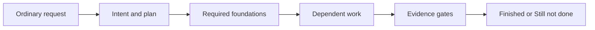

# Moskills Standard — Agent Workflow Router

Managed by moskills. Change this standard in the moskills repo, then run `moskills sync`.

## Route ordinary requests

Users describe work in ordinary language. Select relevant capabilities automatically; slash commands are optional shortcuts, never prerequisites. Explain the chosen route briefly. Use concise natural language by default; compressed styles apply only when requested.

| Request or finding | Capability to apply |
| --- | --- |
| Vague idea or unclear outcome | Preview, then align intent |
| Unclear project terms | Shared language |
| Unfamiliar modules, boundaries, or several files | System map |
| New behavior or changed behavior | TDD where useful |
| Bug, failed check, or unexpected behavior | Diagnose |
| Meaningful progress or context change | Checkpoint |
| Work ready for verification | Gatekeeper |
| Significant decision or implementation | Project DNA |
| Correction, rejected review, confirmed root cause, or a preference to keep | Learn |
| Pause or continuation in another session | Handoff |
| Create, use, list, link, or export a recurring-job guide | Evolvebook |

Use installed skills when available. If a capability or tool is unavailable, perform its documented steps directly and record the limitation; never invent a tool, check, or result.

## Plan and execute

For non-trivial work, record intent, acceptance criteria, constraints, dependencies, and a checkable plan in `tasks/todo.md`. Resolve only missing decisions that block authorized work. Build prerequisites first: shared contracts and foundations before dependent features; integration before final verification. Re-plan when new evidence invalidates the plan.

Use `.claude/standard/delegation.md` for scoped native subagents and bounded review. Work serially when native delegation is unavailable or overhead exceeds its value. No fixed model or role hierarchy is required.

## Evolvebooks

Use `/evolvebook` or ordinary requests to create, use, list, link, or export recurring-job guides. Optional command route: /preview -> /align-intent -> /evolvebook use (if a book matches) -> /system-map -> implementation and checks.

If an evolvebooks home is configured, read its `EVOLVEBOOKS.md` and project `.evolvebooks/EVOLVEBOOKS.md` when present before matching work. Follow the evolvebook skill when a book applies. When the same kind of job has been done three times without a book, propose creating one.

## Run state (proof the tools check)

For non-trivial work with checkable acceptance criteria, keep a run: `moskills run-state` saves each check's exit code, output and file hashes, reopens tasks when checked files change, and refuses to mark a task finished without passing, current proof. When a run exists it is the source of truth for task and gate status; `.claude/STATE.md` and `tasks/todo.md` summarize it.

- **CLI:** use the exact command shown in the `Record proof` line of the plan reminder. Without it, use `moskills` when it is on PATH, else `sh ~/.moskills/moskills`. If none works, work from the Markdown notes and record the limitation.
- **Start once:** `run-state init --goal "<goal>" --scope <files> --tasks "<t1>,<t2>"`. Never re-initialize an existing run; continue it with `run-state resume`.
- **Prove, don't claim:** run each agreed check through `run-state wrap --task <id> --auto-complete -- <command>`. A gate is `passed` only when that proof is current; `resume` reopens tasks whose proof went stale.
- **Human gate:** run `run-state accept --by <name>` only after the user explicitly approves the result in this conversation. Never accept on the user's behalf.

## Completion gates

Choose checks proportionate to changed scope. For each gate, record `passed`, `failed`, `unknown`, or `not applicable` with evidence or a reason:

- **Behavior:** acceptance criteria, relevant tests, and integration paths.
- **Visual:** inspect affected user-facing layouts and states when presentation changes.
- **Code:** relevant static checks and correctness/maintainability review; use document/config review for work without code.
- **Human:** obtain validation when the user requested a completion gate or a consequential decision needs their input. User validation is always required before commit, push, or merge.

A required failed or unknown gate leaves work **Still not done**. Optional unavailable checks remain explicit limitations. Passing implementation checks does not authorize a Git action. Report **Finished** only for the agreed scope, with evidence and any exclusions.

## Rules

- Keep changes small, modular, and within the authorized scope.
- Preserve existing work; never force commit, stash, reset, or cleanup to end a session.
- Never commit, push, or merge without user validation. Use atomic commits when authorized; do not push directly to the default branch.
- Ask before installing dependencies. Show a migration plan before changing database schemas; keep schema implementations internal and export only types and connection factories.
- Record durable state and evidence in `.claude/STATE.md`; track **Finished** and **Still not done** in `tasks/todo.md`.
- Never claim a check passed without observed evidence. When a run exists, its recorded proof decides task and gate status; these files guide everything else.
- Use shared project terms when available. Secrets come from environment variables; follow project environment-file rules and never put tokens in URLs. Pass large payloads via stdin rather than argv.
- Diagrams are required in every documentation artifact you create or update. Include at least one meaningful diagram; prefer Mermaid for Markdown and Obsidian, explain its labels in text, and keep it aligned with the documented workflow, structure, dependencies, or decisions.

- Evolvebooks: read and write only inside the evolvebooks home and project `.evolvebooks/`. When the home is inside a vault, the rest of the vault is off-limits.
