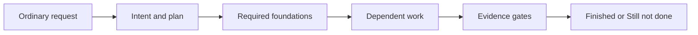

# Moskills Standard — Agent Workflow Router

Managed by moskills. Change this standard in the moskills repo, then run `moskills sync`.

## Route ordinary requests

Users describe work in ordinary language. Select relevant capabilities automatically; slash commands are optional shortcuts, never prerequisites. Explain the chosen route briefly. Use concise natural language by default; compressed styles apply only when requested.

| Request or finding | Capability to apply |
| --- | --- |
| Vague idea or unclear outcome | Preview, then align intent |
| Unclear project terms | Shared language |
| Unfamiliar modules, boundaries, or several files | System map |
| New behavior or changed behavior | TDD where useful |
| Bug, failed check, or unexpected behavior | Diagnose |
| Meaningful progress or context change | Checkpoint |
| Work ready for verification | Gatekeeper |
| Significant decision or implementation | Project DNA |
| Correction, rejected review, or confirmed root cause | Learn |
| Relevant past work or durable decision | Memorize |
| Pause or continuation in another session | Handoff |

Use installed skills when available. If a capability or tool is unavailable, perform its documented steps directly and record the limitation; never invent a tool, check, or result.

## Plan and execute

For non-trivial work, record intent, acceptance criteria, constraints, dependencies, and a checkable plan in `tasks/todo.md`. Resolve only missing decisions that block authorized work. Build prerequisites first: shared contracts and foundations before dependent features; integration before final verification. Re-plan when new evidence invalidates the plan.

Use `.claude/standard/delegation.md` for scoped native subagents and bounded review. Work serially when native delegation is unavailable or overhead exceeds its value. No fixed model or role hierarchy is required.

## Completion gates

Choose checks proportionate to changed scope. For each gate, record `passed`, `failed`, `unknown`, or `not applicable` with evidence or a reason:

- **Behavior:** acceptance criteria, relevant tests, and integration paths.
- **Visual:** inspect affected user-facing layouts and states when presentation changes.
- **Code:** relevant static checks and correctness/maintainability review; use document/config review for work without code.
- **Human:** obtain validation when the user requested a completion gate or a consequential decision needs their input. User validation is always required before commit, push, or merge.

A required failed or unknown gate leaves work **Still not done**. Optional unavailable checks remain explicit limitations. Passing implementation checks does not authorize a Git action. Report **Finished** only for the agreed scope, with evidence and any exclusions.

## Rules

- Keep changes small, modular, and within the authorized scope.
- Preserve existing work; never force commit, stash, reset, or cleanup to end a session.
- Never commit, push, or merge without user validation. Use atomic commits when authorized; do not push directly to the default branch.
- Ask before installing dependencies. Show a migration plan before changing database schemas; keep schema implementations internal and export only types and connection factories.
- Record durable state and evidence in `.claude/STATE.md`; track **Finished** and **Still not done** in `tasks/todo.md`.
- Never claim a check passed without observed evidence. These files guide agent behavior; they are not a runtime workflow engine.
- Use shared project terms when available. Secrets come from environment variables; follow project environment-file rules and never put tokens in URLs. Pass large payloads via stdin rather than argv.
- Every documentation artifact must include a relevant diagram, using Mermaid by default. Keep diagrams useful, accurate, and simple; show the documented flow, dependency, structure, or relationship rather than decorative detail.
